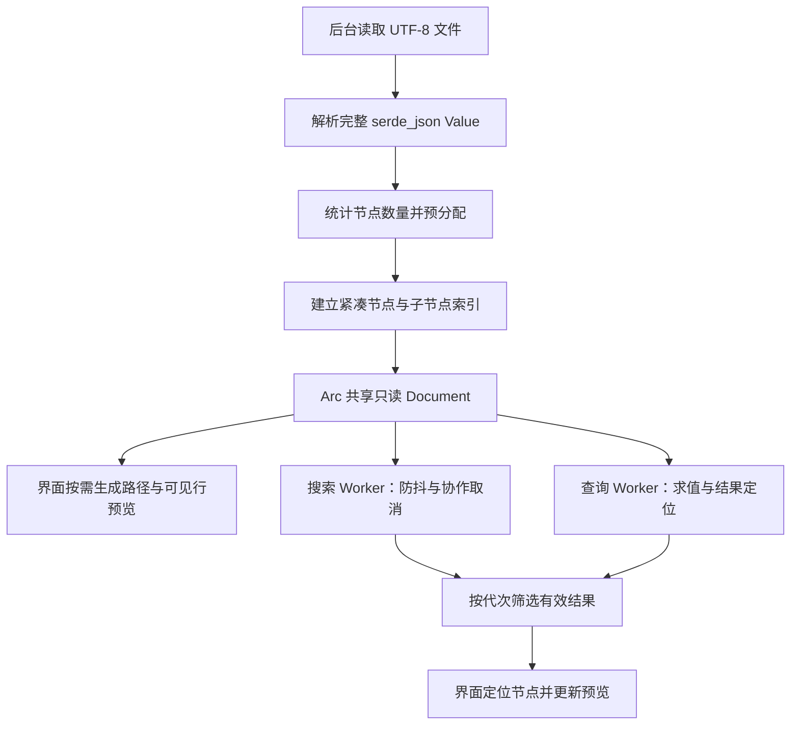

# FerrisJson 0.4.0 大文件优化：实现步骤与原理

本文记录已经实现的第一阶段优化：在保留完整 `serde_json::Value` 和现有查询语义的前提下，压缩附加索引、减少字符串复制及临时分配，并将检索移出界面线程。

记录日期：2026-10-12。实现与版本提交为 `c9f0415`（0.4.0）；对照版本为 `455403f`（0.3.5）。未来的大文件按需解析方案见 [todo.md](../todo.md)，不属于本文已经实现的功能。

## 1. 原实现为什么慢、为什么占内存

原加载流程是：读取整个文件为 `String`，解析为 `serde_json::Value`，再递归建立完整树索引。读取与解析虽然在后台执行，但在加载期间，源文本、Value 与正在建立的索引会同时占用内存。

原来的每个 `Node` 保存五个独立字符串：`key`、`pointer`、`path`、`preview` 和 `searchable`。这些数据与 Value 中的键和值存在重复：

- 对象键已经保存在 Value 中，又被节点复制一次。
- 字符串值已经保存在 Value 中，又被复制为完整的搜索字符串。
- 每个节点保存从根开始的两种完整路径，相邻节点重复保存大量共同前缀。
- 折叠、未显示的节点也会在加载时生成预览。

在本机 64 位构建中，原 Node 结构体为 176 字节，尚未计算字符串内容和分配器开销。`Vec` 扩容留下的容量余量还会放大索引占用。

原 JSONPath 流程每次都遍历所有节点，建立 `HashMap<&str, usize>`，随后把查询结果的位置转为 JSON Pointer 字符串，再查询这个映射。因此，即使只查询 `$.records[0].email`，也要支付一次全量索引构建成本。

原搜索在搜索框每次变化时执行，扫描所有节点并占用界面线程。读取文件异步，不能解决检索导致的界面停顿。

## 2. 优化后的整体流程



这仍然是完整内存文档模型。按需生成的是路径、树行标签和预览；文件本身并没有按需读取，Value 和结构索引也没有改为流式或磁盘存储。

## 3. 步骤一：压缩节点结构与共享键名

实现位置：[src/document.rs](../src/document.rs)，主要类型为 `Kind`、`Node`、`Document` 和 `IndexBuilder`。

### 3.1 节点只保存结构信息

新的 Node 保存：

| 字段 | 含义 |
| --- | --- |
| `parent` | 父节点 ID；根节点为 None |
| `depth` | 树层级，供缩进与初始展开使用 |
| `end` | 前序序列中子树结束后的第一个 ID |
| `segment` | 对象键的共享编号，或数组元素的整数下标 |
| `child_start` / `child_count` | 此节点的直接子节点在 children 数组中的范围 |
| `kind` | 类型枚举，按需得到类型名称及是否为容器 |

节点不再持有上述五个字符串。在本机 64 位构建中，Node 为 64 字节。这个值由实测和回归测试确认，不是跨所有架构的固定 ABI 承诺。

### 3.2 索引中的相同键名只保留一份内容

`Document.keys` 保存 `Arc<str>`，`key_ids` 将键名映射为共享编号。索引构建遇到重复的 `email` 时复用已有编号；节点只保存编号。keys 与 key_ids 中的 Arc 指向同一份字符串内容。

这里去重的是附加索引。原始 Value 中每个对象拥有的键名仍然存在，并未被改造成共享字符串。数组下标也只在节点中保存为整数，在需要显示时才转成字符串。

### 3.3 前序 ID 与查找顺序分开

节点按原 Value 的顺序进行前序编号，所以原始对象键顺序和数组顺序继续用于显示。`end` 使折叠容器时可以直接跳过整个子树，原有导航和展开/折叠逻辑继续使用同一套 ID。

另外建立一个 `children: Vec<usize>`，每个非根节点在其中有一条父子边。对象的直接子节点按共享键编号排序，以便二分查找；数组的直接子节点按下标排列。这个排序只改变查找表，不改变节点前序 ID 和显示顺序。

## 4. 步骤二：统计数量，减少扩容余量

`Document::parse` 先完成 Value 解析，再用 `node_count` 统计全部节点数 N，然后分别为 nodes 和 children 预分配 N 与 N−1 的容量。

这样避免两个大型数组在索引构建过程中不断增长、搬移，以及保留远高于实际长度的容量。代价是额外遍历一次 Value；它不复制字符串，也不构造路径。

对本机 64 位布局，结构数组的有效负载可近似表示为：

```text
节点数组 ≈ 64 × N 字节
子节点数组 ≈ 8 × (N − 1) 字节
总结构数组 ≈ 72 × N 字节
```

这是结构数组的估算，不是总进程内存。Value、共享键表、源文本、查询结果、界面状态、字体和分配器都需要另外计算。索引建立还包含对象子节点的局部排序，其成本随各对象的字段数量变化。

## 5. 步骤三：路径和值按结构定位

主要方法为 `at`、`key`、`ancestors` 和 `path`。

`at(id)` 沿父节点链找到对应 Value：对象通过共享键名访问，数组通过整数下标访问。这里返回原 Value 的引用，不复制选中值；也不再通过完整 JSON Pointer 字符串重新解释路径。

`key(id)` 用 `Cow<str>` 返回键：对象键与根标签借用现有内容，数组下标才生成临时字符串。

`path(id)` 只在需要选中路径、复制路径或命令行输出时生成完整 JSONPath。它从当前节点追溯父节点、反转祖先序列，再拼接对象名或数组下标。普通标识符使用点号，特殊键名使用经 JSON 转义的方括号字符串，保留中文、空键名、引号和斜杠等情况的可定位性。

这把原来按全部节点长期保存的路径，改为少数当前需要的临时路径。代价是获取值或生成路径需要沿深度 D 访问祖先，并不是所有节点访问都变成 O(1)。界面缓存当前选中路径，避免每帧重复构造。

用于路径回归检查的 `pointer` 方法仅在测试构建中启用；生产节点不保存完整 Pointer 字符串。

## 6. 步骤四：查询结果直接沿树定位

主要方法为 `child_name`、`child_index`、`pointer_id`、`query_path` 与 `query_path_cancellable`。

### 6.1 JSON Pointer

Pointer 被分成多个段，逐段访问对象或数组：

1. 检查 `~` 后只能跟 `0` 或 `1`。
2. 按正确顺序解码 `~1` 和 `~0`。
3. 对象名先查询共享键编号，再在该对象的直接子节点中二分定位。
4. 数组下标检查前导零、加号及范围，再直接访问对应子节点。

不再扫描所有节点去比较完整 Pointer。对象中的数字键名仍然作为字符串键处理，不能与数组下标混同。

### 6.2 JSONPath

表达式仍由 `serde_json_path` 解析和求值，调用 `query_located(&value)` 获取带位置的结果。每个结果的位置由 `PathElement::Name` 或 `PathElement::Index` 组成；代码从根节点依次沿这些元素定位到节点 ID。

因此删除了每次查询时的全量 Pointer HashMap，也避免把每个结果的位置先序列化为 Pointer 字符串。返回结果保持查询引擎给出的顺序，不排序、不去重；例如 `[1,0,1]` 会保留重复选择。

数组的单步结构定位为 O(1)，对象的单步定位包含共享键查询和直接子节点二分查找。精确小结果查询不再承担额外 O(N) 的映射构建开销，但这不意味着所有 JSONPath 都是常数时间。递归、通配符和过滤表达式仍可能遍历大量 Value，查询库也仍会构造完整的 LocatedNodeList。

## 7. 步骤五：搜索复用原始值与唯一键匹配

主要方法为 `search_cancellable` 与 `walk`。

搜索不再读取节点中的完整 `searchable` 副本，而是按与索引一致的前序顺序遍历原 Value。这保证遍历计数和节点 ID 对应，不需要为每个值调用从根开始的 `at`。

具体减少了以下工作：

- 每个唯一对象键仅匹配一次，结果存入临时 `key_matches`。节点用共享键编号复用结果。
- 字符串值直接匹配 Value 中的完整解码字符串，不能只搜索被截断的预览。
- 在已启用 arbitrary_precision 的配置下，数字用 `Number::as_str()` 匹配，不生成新的数字字符串；布尔与 null 使用静态文本。
- 普通文本搜索若包含非 ASCII 数字字符，就不可能匹配纯数字数组下标，因此跳过数组键的字符串转换与匹配。正则搜索继续匹配数组下标。
- All 模式中，键已匹配时不用再次检查值，因为每个节点只需返回一次。

匹配仍按前序 ID 返回，兼容当前的结果导航和二分高亮。大小写、正则、键/值范围和 Unicode 行为继续由现有正则引擎及回归测试保证。

搜索的主要复杂度仍与节点数和被匹配文本长度有关；这里没有建立全文倒排索引。结果 ID 也仍完整保存在 Vec 中，不是逐批返回或分页结果。

## 8. 步骤六：预览按需生成，并在输出上限处停止

实现涉及 `row_preview`、`SelectedValues`、`bounded_preview` 与 [src/app.rs](../src/app.rs) 中的行标签缓存和选中预览。

### 8.1 可见树行

只绘制可见行是已有能力，本次没有把它作为新功能。新增的是只为实际需要显示的行生成键标签和短预览，再缓存这些标签。

缓存最多保存 512 行。需要插入第 513 个不同节点时清空缓存再插入；这不是 LRU 淘汰。它限制缓存行数，不构成严格的总字节预算，因为原始键名可能很长。

字符串和数字的树行预览截取前 160 个字符，超出时添加省略号。完整值仍用于搜索、选中预览、复制和导出。选中节点未变化且已有预览时复用当前预览；新文档加载成功时清空行缓存和选中预览。

### 8.2 查询结果预览

之前先为所有结果解析 Value 引用并收集到一个 Vec，再执行有输出上限的格式化。结果数量很大时，即使只显示前 200 KB，也必须先处理全部结果引用。

现在 `SelectedValues` 实现 `Serialize`，通过 `SerializeSeq` 每次序列化一个结果。`bounded_preview` 的 writer 到 200,000 字节上限后返回截断错误，序列化立即结束，后续结果不再被解析成 Value 引用。

上限按字节计算，并在展示前保留完整 UTF-8 边界。完整复制/导出的 `results_json` 也使用逐项序列化，减少中间引用数组，但仍生成完整输出 String；它没有变成直接写磁盘的流式导出。

此改动缩小的是预览阶段的临时分配与访问范围，不能消除查询引擎先前已经生成的结果集合。大字符串单次匹配或序列化内部扫描仍可能花费时间，不能将输出上限解释为严格的 CPU 时间上限。

## 9. 步骤七：共享只读文档，后台执行检索

实现位置：[src/worker.rs](../src/worker.rs)；界面调用见 `search`、`go_to_path` 和 `poll_operations`。

Viewer 使用 `Arc<Document>`，Worker 通过 `Arc::clone` 共享只读文档，不复制整棵 Value 或索引。搜索和查询各使用一个独立 Worker，避免一个类型的任务直接阻塞另一个类型的任务。

每个 Worker 的容量约束是：

| 位置 | 约束 |
| --- | --- |
| 正在执行 | 一个任务 |
| 待执行 Inbox | 一个 Option，请求可被最新请求替换 |
| 完成结果通道 | `sync_channel(1)`，最多一个已缓冲结果 |

线程通过 Mutex 与 Condvar 等待新请求；界面用非阻塞轮询取结果。若结果通道满，等待发生在 Worker 的发送端。这个机制限制请求和结果堆积，不是每提交一次就新建线程。

它也不限制单个任务自身的结果大小。等待发送的 Worker 还可能持有自己的完成结果，活动任务也可能暂时保留旧文档的 Arc；不能把通道容量等同于完整进程内存上限。

完成后 Worker 请求界面重绘；有活动任务或防抖计时器时，界面另安排最多约 50 ms 间隔的轮询重绘。展示结果、展开祖先、更新选中值和树行仍在界面线程执行。

## 10. 步骤八：防抖、任务代次和取消边界

### 10.1 200 ms 防抖

搜索文本、大小写、正则或范围变化时，先失效旧搜索、清除旧匹配，再设置 200 ms 截止时间。连续输入重设截止时间，只在停顿后提交最新搜索。Enter 可直接调用 search，不必等截止时间。

防抖减少短时间内的重复全量扫描，但故意增加了输入后的等待时间。它改善交互，不等于一次搜索的计算速度提高。

### 10.2 代次保证结果属于当前请求

Worker 用 `AtomicU64` 保存 generation。取消或新提交递增代次，清空旧的待执行请求和已缓冲结果。每个请求、完成结果携带自己的代次。

Worker 在处理前后检查是否过期；Viewer 取结果时再次比较代次。过期结果不能覆盖最新搜索、最新查询或新加载的文档。清空搜索、清空/Reset 查询，以及新文档加载成功都会使相应任务失效。

### 10.3 协作取消不是随时强制中断

搜索在唯一键匹配和节点遍历中每 1024 项检查一次代次。取消后停止继续扫描，丢弃已收集的结果；单次正则匹配中的巨大字符串扫描仍不能在任意字节处被外部打断。

查询在求值前、求值后及每 1024 个结果定位时检查代次。现有库的 `query_located` 没有中途取消接口，所以表达式求值本身必须返回后才可继续检查。过期请求会跳过后续格式化，并在发送前再次检查代次。

因此旧的复杂查询可能继续占用查询 Worker 一段时间，但不会在界面线程求值或把旧结果展示为当前结果；期间待执行请求不断合并为最新一个。

## 11. 测量方法与结果

这次测量使用本机 macOS/arm64、Rust 1.99、优化编译的临时基准程序。程序读取文件，直接调用两个版本的 Document 实现，测量解析建索引、搜索和查询；进程峰值 RSS 用 macOS `/usr/bin/time -l` 的 maximum resident set size 记录。

输入为同一份 21,177,793 字节（约 20.2 MiB）的合成 JSON：根对象包含 records 数组，10 万条记录、1,300,002 节点。记录含数字 ID、email、多语种 name、布尔值、tags 数组、address 对象和任意精度大整数。原始数据构造方式为紧凑 JSON，记录结构如下：

```json
{
  "id": 0,
  "email": "user0@example.com",
  "name": "测试 사용자 テスト",
  "active": true,
  "tags": ["rust", "json", "viewer"],
  "address": {"city": "Shanghai", "code": 200000},
  "balance": 123456789012345678901234567890
}
```

以下是最后一次顺序运行的实际输出，时间保留两位小数，RSS 四舍五入为 MiB：

| 指标 | 原实现 | 优化后 |
| --- | ---: | ---: |
| 文件读取 | 9.59 ms | 12.27 ms |
| 解析 + 完整索引构建 | 515.85 ms | 149.87 ms |
| 进程峰值 RSS | 704 MiB | 318 MiB |
| Node 结构体大小 | 176 B | 64 B |
| nodes 容量对应的结构体空间 | 352.00 MiB | 79.35 MiB |
| 原节点五个字符串的容量合计 | 153.72 MiB | 不再保存在节点中 |
| 全范围、忽略大小写搜索 missing-needle（零匹配） | 19.44 ms | 11.43 ms |
| 全范围、忽略大小写搜索 email（10 万匹配） | 27.77 ms | 13.51 ms |
| 查询 `$.records[0].email`（一个匹配） | 45.87 ms | 0.10 ms |
| 查询 `$.records[*].email`（10 万匹配） | 97.62 ms | 36.95 ms |

峰值 RSS 原始值分别为 738,033,664 和 333,611,008 字节。它涵盖基准进程读取、索引、检索等阶段的峰值，不是只测 Node；优化后的 children 数组和共享键表也属于进程占用，不能用 nodes 的一行代替总索引占用。

这是单次基准，未做多次统计、冷缓存控制或独立阶段内存测量，且不含完整 GUI、字体、绘制或防抖等待。也不是工作区 `random-0.6gib.json` 的测量，不能直接外推其打开时间或内存。旧的另一轮测量为约 714 ms / 695 MiB，波动说明应在后续建立固定数据集与多次运行的基准。

## 12. 已完成验证与可重复检查

优化后主程序 31 项自动测试通过，覆盖特殊路径、共享索引、对象顺序、数组下标、JSONPath 重复结果、大整数、Unicode、搜索模式、预览早停、任务替换、代次过滤、新文档失效旧结果及防抖，并包含已有导航、配色与界面测试。

```sh
cargo fmt --check
cargo test --offline --locked
cargo clippy --offline --locked --all-targets -- -D warnings
cargo check --offline --locked --all-targets
```

首次使用 offline 前需要准备依赖。主程序测试数量不代表生成器 example 的测试已运行；生成器需另执行 `cargo test --offline --locked --example generate_json`。

macOS/arm64 App 已重新构建，Info.plist、ad-hoc 签名、JSONPath 与搜索 CLI 样例验证通过。该次构建发生在版本号仍为 0.3.5 时；随后提交 0.4.0 并通过全部目标的 cargo check。需要带 0.4.0 版本信息的最终产物时，重新执行：

```sh
cargo run --release --locked --example package
```

实际 Windows / Intel Mac 验收、真实大文件的完整 GUI 压测、多轮基准和大结果复制/导出尚未完成。

## 13. 第一阶段没有解决的部分

- 完整源文本在加载时与 Value/索引共存；完整 Value 和结构索引长期驻留。
- 旧文档在新文档加载期间仍供界面使用，旧活动任务也可能继续持有它，新旧文档会暂时重叠。
- 全局文本、正则、递归查询仍需访问大量数据；后台执行只改善界面响应，不能免去扫描。
- 搜索和查询返回完整结果列表，没有渐进批次、分页或结果数量预算。
- 表达式求值和单次正则匹配不是可任意打断的执行过程。
- 复制与导出仍可能创建完整格式化 String；树行缓存也只限制条目数。

下一阶段应评估原文件字节范围索引、按需子树解析、具有字节预算的缓存，以及与这种存储模型兼容的查询后端。具体待办和验收条件统一维护在 [todo.md](../todo.md)。
