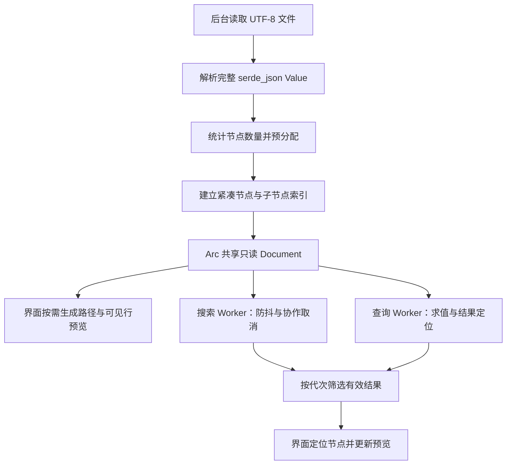

# FerrisJson 大文件优化记录：0.4.0–0.7.9+3

## tui 分支：Linux TUI（2026-10-17，基于 0.7.9+3）

按目标系统隔离界面与依赖：Linux 使用 Ratatui/Crossterm，Windows/macOS 保留 eframe/rfd。TUI 复用现有 Task、Navigator、PagedTree、SearchHub、QueryHub 及输出通道，只增加终端刷新适配；树帧最多 64 行，结果每页 16 条，不生成全部可见树行。共用文件后端预算、取消、会话及完整／部分输出约束不变，终端显示中的控制字符会转义。增加 Linux 主机自动编译／打包分支；详细交互、边界与复现命令见 [Linux TUI 接入记录](linux-tui.md)。

仅完成源码实现、依赖解析／下载及静态源码/API/锁文件阅读；原有锁定包的名称和版本保留。未运行测试、构建、check、Clippy、格式检查、TUI、GUI、打包或基准，没有新增性能数字，也不宣称 RSS、加载速度或交互响应改善。Memory 高级查询的完整收集／取消边界、Indexed 完整结构索引、Sparse 实验性与高密度目录限制仍在；Memory 分页任务预算 256 MiB 不是 RSS 上限，stdin 仍完整读入，终端文字与功能键依赖环境。

版本号仍为 0.7.9+3，按用户明确要求提交到 `tui` 分支，未构建或验收，不将提交授权记为验收通过；旧版本和原始测量保持原样。用户后续专项仍按十进制 100 MB / 300 MB / 500 MB、低命中与高命中，区分 TUI 与历史 GUI/引擎口径，样本／测试 JSON 和基准 JSON 报告只留本地。Windows/macOS 回归与 Linux 本地／SSH／无图形环境／退出恢复等待用户实测；S0 保持暂停。

## 38. 0.7.9+3 — JSONPath Cheatsheet（2026-10-17）

默认 GUI／分页树 JSONPath 栏及现有帮助页增加可点击入口，共用独立滚动语法窗口，提供选择器、标量过滤、逻辑组合及后端限制说明和逐项 Copy。复制不执行查询，弹窗期间暂停树键盘导航，Esc 关闭。

只阅读源码差异并与现有查询语法／阶段 E 支持范围对照；未运行测试、构建、Clippy、格式检查、GUI 或基准，布局与交互待用户验收。没有查询算法改动或新增性能测量，按用户明确要求提交为 0.7.9+3（本次版本提交），同步 Cargo 两文件、README 和 TODO；核对源码差异、版本与暂存清单，不将提交授权写为实测通过。后续专项仍为十进制 100／300／500 MB 低／高命中，S0 暂停，保留历史测量。

## 37. 0.7.9+2 — 系统打开文件快捷键（2026-10-17）

默认 GUI、分页树和旧有限页浏览器使用 egui COMMAND 映射，捕获 macOS ⌘O／Windows 和 Linux Ctrl+O，在文本输入之前消费按键并复用现有文件选择与加载流程。现有加载限制及应用弹窗键盘屏蔽规则保留。

只阅读本地 egui 输入实现与源码差异，未运行测试、构建、Clippy、格式检查、GUI 或基准，跨系统交互等待用户验收；没有性能算法改动或新增测量。按用户明确要求提交为 0.7.9+2 / `d35a5da`，同步 Cargo 两文件、README 和 TODO，只核对源码差异、版本与暂存清单，不将提交授权写为实测通过；专项仍为十进制 100／300／500 MB 低／高命中，S0 暂停。

## 36. 0.7.9+1 — 中文与 emoji 字体修订（2026-10-17）

macOS 增加 Font8／Font7 资源目录发现苹方，按字体名选择 SC Regular；没有苹方时优先使用中文字体，再回退到韩文／日文字体。同一中文候选组只加载一个集合。随程序嵌入 Noto Emoji 轮廓字体（约 1.9 MiB 文件），替换 egui 原有同名字体；文件大小不是 RSS、二进制增量或启动耗时测量。来源、许可证和哈希见 [字体说明](../assets/fonts/README.md)。

只阅读源码、系统字体目录／名称表和字体许可证，未运行测试、构建、Clippy、格式检查、GUI 或基准，无新增性能结论。中文对齐、混排与 emoji 覆盖等待用户实机验收；emoji 为单色，复杂序列未接入完整塑形。按用户明确要求提交为 0.7.9+1 / `9d4571e`，同步 Cargo 两文件、README 和 TODO；核对源码差异、版本与暂存清单，不将提交授权写为实测通过。后续专项仍为十进制 100／300／500 MB 低／高命中，S0 暂停，历史测量不变。

## 35. 0.7.9 — 相对行号与 JSONPath 结果跳转（2026-10-17）

默认树及 Sparse／Legacy 分页树增加 Vim 风格相对行号，按展开后的可见树行计算；当前行保留绝对行号。JSONPath 增加上一项／下一项按钮、序号与 F4／Shift+F4，使用独立查询游标，首尾循环并跟随结果页定位。默认 GUI 复用后台有界结果页读取，分页树复用查询定位队列；扫描中只遍历已发布前缀。旧有限页浏览器保持既有范围。

仅阅读源码差异，未运行测试、构建、Clippy、格式检查、GUI 或基准，功能待用户验收；没有新增性能数据或提速结论，按用户明确要求提交为 0.7.9 / `fab31cb`，同步 Cargo 两文件、README 和 TODO；仅核对源码差异、版本与暂存文件列表，不将提交授权写为实测通过。既有查询语法、Memory 高级查询及预算限制不变；大文件专项仍按十进制 100／300／500 MB、低／高命中，S0 暂停，历史测量不改写。

## 34. 0.7.8+1 — 默认 JSONPath 栏修订（2026-10-16）

基于 0.7.8 / `61f1488`，按用户明确要求提交为 0.7.8+1 / `b211e2f`。默认 GUI 移除 Go，查询由 Enter 执行；Reset 改为输入框内 ×，清空表达式和结果、取消查询并清除耗时。输入框按展开／折叠按钮宽度分配剩余空间；分页树入口及查询执行语义保持原范围。

仅 UI 调整，没有新增性能算法或性能测量。按用户约定未运行测试、构建、Clippy、格式检查、GUI 或基准，仅核对源码差异、版本文本和暂存文件列表；不将提交授权写为验收通过。查询语法、Memory 库内取消、完整结构索引和资源预算等既有限制不变，布局与交互尚无新增实测通过记录。后续大文件专项仍为十进制 100／300／500 MB、低／高命中，S0 暂停；保留历史测量版本及样本，不纳入样本／测试 JSON 或基准 JSON 报告。

## 33. 0.7.8 — F 分页树查询与兼容边界（2026-10-16）

基于 0.7.7 / `b730729` 将 E 的查询引擎接入 Sparse／Legacy 分页树：独立 QueryHub 生产线程、最新请求／输入槽及共享状态，完整验证后派发；结果每页 16 条，点击定位，支持取消及完整／固定部分前缀复制和导出。查询、搜索的请求和取消代次独立，页读取复用 Interactive 通道、输出复用单任务输出通道。新旧 API 用 run／collect 和显式 compatibility 契约区分，历史调用行为保留。详见 [F 实施记录](search-query-stage-f.md)。

公共值输出改用只取节点的游标；值导出不再预留原路径导出的 64 MiB 工作区，路径导出保持既有处理。分页树复制仍保留 8 MiB 边界，较大结果提示导出；查询页预留 64 KiB，结果及输出继续受共享预算保护。这些是实现参数和分配路径变化，不是测量所得 RSS 降幅或耗时改进。Memory 高级查询仍完整收集且库内不可取消；默认完整树、兼容 API 及文件过滤范围等限制不变。

验证结果：只阅读源码与差异、核对取消／队列／文档、版本文本及暂存文件列表，未新增或运行测试，未运行构建、Clippy、格式检查、GUI 或基准。按用户明确要求提交为 0.7.8（本次版本提交），Cargo 两文件和项目文档同步，不将提交授权写为实测通过；无新增性能数据。后续专项仍为十进制 100／300／500 MB、低／高命中，历史测量和样本版本保留原值，S0 继续暂停。

## 32. 0.7.7 — E 流式查询与标量过滤（2026-10-16）

基于 0.7.6 / `f21db89` 实现独立语法层、标量谓词及逐节点查询管线，复用 Provider 和磁盘 ResultStore。默认 GUI 结果每页 16 条，生产／读取使用独立有界任务通道；复制与导出用完整或固定部分前缀游标，主 CLI 和 `sparse_index --query` 接入新执行器。第一条结果立即发布，其后按 128 条批次或工作检查点间隔发布，不将全部选择器中间结果收集为 Vec。详见 [E 实施记录](search-query-stage-e.md)。

实现中的保护参数：最多 128 个查询步骤、127 层树路径、受限过滤嵌套／逻辑运算符；单次读取的过滤标量编码最多 256 KiB。计划、遍历和标量工作区预留共享内存预算，结果与祖先写入受磁盘预算保护；没有恢复已取消的结果条数或 256 MiB 结果 ID 固定上限。这些是实现边界，不是实测 RSS 或延迟承诺。

Memory 过滤和高级语法保留原库兼容路线，仍有完整结果及库调用内部不可取消限制；旧 NodeIds API 仍采用 D 的语法与收集行为。完整结构索引、默认 GUI 树／行数组未分页；稀疏查询目前只接 API／CLI，分页树 GUI 查询面板待 F，文件后端不支持函数、多节点过滤操作数及容器比较。新路线增加临时磁盘读写，不能据此声称提速或降低总内存。

验证结果：仅人工阅读源码与差异、核对入口、版本文本、文档及暂存文件列表；按用户要求未新增／运行测试，未运行构建、Clippy、格式检查、GUI 或基准。用户明确要求提交为 0.7.7（本次版本提交），Cargo 两文件和项目文档同步；不将提交授权写为实测通过。没有新性能数字；后续专项仍为十进制 100／300／500 MB、低／高命中分别记录，命令列于 E 记录但本次未执行。S0 继续暂停，历史样本和真实测量版本保持原样。

## 31. 0.7.6 — D 独立查询引擎与后端适配（2026-10-16）

基于 0.7.5+1 / `5bfeb23` 将 JSONPath／Pointer 规范化、求值和结果定位移入 engine/query，提供公共请求、编译对象、能力矩阵及三个后端适配；Document／SparseIndex 仅留兼容入口，GUI Worker 和主 CLI 使用引擎。规范化字符串使用共享预算和可失败分配，编译对象绑定会话／后端；原查询库 AST、解析临时分配、完整 NodeIds 及 Indexed 中间数组的限制仍在，不声称固定总内存、流式求值或加速。详见 [D 实施记录](search-query-stage-d.md)。

没有新性能测量、测试、构建、Clippy、格式检查或专项验收；按用户明确要求同步版本和项目文档，提交为 0.7.6（本次版本提交）；只核对源码差异、版本文本及暂存文件清单，不将提交授权当作测试通过。E 未实施，S0 暂停；后续专项仍用十进制 100／300／500 MB 的低／高命中，不改写历史样本版本。

## 30. 0.7.5+1 — 搜索栏 UI 修订（2026-10-16）

基于 0.7.5 / `0764d03`，按用户要求提交为 0.7.5+1（本次版本提交）：合并默认搜索栏，输入框内 × 清空、其右侧转圈点击取消，匹配导出移到值预览 Export 旁。只改变展示与入口，不新增性能算法或基准数据；未运行测试、构建、Clippy、格式检查或 GUI 验收，只核对版本文本、源码差异和暂存文件列表，不将提交授权记为测试通过。

没有新增性能改动或测量数据。后续大文件专项仍为十进制 100／300／500 MB，覆盖低／高命中；本次未执行，S0 保持暂停。既有后端、Regex、结果部分／完整及资源预算限制不变，历史版本和原始测量样本不改写。

## 29. 0.7.5 — 阶段 C 公共结果存储与默认搜索迁移（2026-10-16）

基于 B / `bf5f69d`（包版本 0.7.4）将结果分页存储提取到 engine/results，提供有预算的页、保留顺序／重复项的追加与前缀游标，共享 Provider 输出。默认 GUI 搜索改接 SearchHub／磁盘 ResultStore；视口命中与目标节点在独立有界 Interactive 读取通道处理，绘制不读取结果磁盘；新增明确取消后部分结果和完整／部分值／路径导出。具体边界与待验收项见 [C 实施记录](search-query-stage-c.md)。

这些是实现变化，没有测试、构建、Clippy、格式检查或性能测量；不报告加速、RSS 降幅或固定总内存承诺。旧 GUI 的树／行数组、JSONPath NodeIds 和主 CLI 兼容收集仍保留；临时磁盘增加成本，资源失败明确处理。按用户明确要求同步 Cargo.toml／Cargo.lock、README、TODO 及本记录，提交为 0.7.5（本次版本提交）；提交前仅核对版本、源码差异与暂存文件清单，不将提交授权作为实测通过；S0 暂停，后续专项仍为十进制 100／300／500 MB 的低／高命中，历史记录不改写。

## 阶段 B 类型与状态隔离（2026-10-16，提交 bf5f69d）

基于 0.7.4 / `2ff76c0` 完成独立搜索／查询请求及 Worker，公共泛型有界调度移除 Search／Query 分支；搜索和查询耗时同时保留，查询成功不清除通用错误。具体职责与验收项见 [B 实施记录](search-query-stage-b.md)。当前仍为兼容执行器，默认 GUI 完整收集 NodeIds，分页树保留 SearchHub；没有新增流式查询或性能测量，不声称内存／耗时改善。已有用例仅迁移源码，按用户要求未运行测试、构建、Clippy、格式检查或基准，等待用户验收后提交。包版本仍为 0.7.4，S0 暂停，历史测量保持原版本。

## 28. 0.7.4：双引擎阶段 A 与取消固定结果上限（2026-10-16）

按用户要求收录为 0.7.4（本次版本提交）。本次新增 [阶段 A 行为基线](search-query-separation.md)，核对搜索／JSONPath 的三个后端与入口、已有语义及待验收缺口，尚未实施引擎迁移。按用户追加要求取消旧搜索兼容收集器 65,536 条命中上限、Indexed 查询单个结果 ID 数组 256 MiB 固定上限。两处扩容均经过 NodeIds／reserve_vec 的共享账本、整数溢出检查与可失败分配；采用按容量增长，避免解除上限后逐条精确扩容。旧结果及 Indexed 中间结果仍完整驻留内存，扩容还需预留旧／新缓冲重叠，不承诺无限结果或固定总 RSS。

原“超 65,536 条必须报错”的回归断言已同步为返回 65,537 条及首末节点检查，未运行。本次按用户要求未执行测试、构建、Clippy、格式检查和基准，无耗时／内存改善数据。大文件专项若后续执行仍采用十进制 100／300／500 MB，低／高命中分别记录，S0 保持暂停。超旧 256 MiB 边界、预算不足、GUI 与 CLI 实际行为均待用户验收；用户明确指示提交为 0.7.4，不将提交授权记为测试通过。历史 S6 的限制与原始测量版本保持不变。

本文记录第一阶段及后续内存优化：在保留完整 `serde_json::Value` 和现有查询语义的前提下，压缩附加索引、减少字符串复制及临时分配，并将检索移出界面线程。第 15 节记录 0.4.2 的紧凑索引与低内存加载；第 16 节记录 0.4.3 的导出、复制、缓存和结果编号优化。

更新日期：2026-10-17，当前版本 0.7.9+3。第 38 节记录 JSONPath Cheatsheet 及未实测状态。第 37 节记录系统打开快捷键及未实测状态。第 36 节记录中文与 emoji 字体修订及未实测状态。第 35 节记录相对行号与 JSONPath 跳转及未实测状态。第 34 节记录 UI 修订，第 33 节记录 F、第 32 节记录 E 的实现与未实测状态。第 27 节记录本次检索高亮改动及未验收状态，没有新增性能测量。第 24 节记录 S4，实现阶段测量版本为 0.6.2，0.7.0 提交前验证另列。第 1–13 节保留 2026-10-12 的第一阶段记录：实现与版本提交为 `c9f0415`（0.4.0），对照版本为 `455403f`（0.3.5）。第 14 节记录 0.4.1 的源文本释放和 Windows 内存基准；原始测量时包版本仍为 0.4.0，报告中的版本号保留原值，不改写历史样本。第 17 节记录 0.5.0 的可选文件索引与按需子树；剩余兼容和分页方案见 [todo.md](../todo.md)。

## 27. 0.7.3 — 非 JSONPath 检索高亮（2026-10-16）

基于 0.7.2 / `a8f2980`，本次版本提交将普通检索高亮应用到默认 GUI 和分页树的树行、选中值预览及结果显示。大小写、正则和键／值范围参与高亮；完整 JSON 字符串按解码文本匹配并映射回转义显示。分页预览布局缓存随高亮查询变化失效，修改条件时清除旧高亮；移除未使用的 `json_preview` 包装函数。

本次属于显示功能修改，没有新的性能优化或基准数据。按用户要求未运行测试、格式检查、Clippy、构建、原生 GUI 或专项基准，只核对版本文本和暂存列表。用户提供的编译警告截图来自仍标记为 0.7.2 的工作区，不能作为 0.7.3 构建通过或警告消除的验证证据。

基准口径保持：后续专项默认十进制 100 MB / 300 MB / 500 MB，分别覆盖低命中和高命中；历史测量版本、样本大小、哈希和结果保持原样，不将 0.7.1 / 0.7.2 的结果视为本版数据。S0 继续暂停，不新增速度、内存或 FPS 声明。

剩余限制：高亮只作用于已有显示文本，截断部分不补读，零宽正则不着色；截断或不完整 JSON 字符串的显示匹配可能与完整值检索不同。Unicode／转义、正则锚点、范围切换、预览缓存、主题和大文件显示开销仍待实际验收；既有原生 GUI、跨平台、RSS 与真实磁盘故障限制不变。样本／测试 JSON 及基准 JSON 报告继续仅保存在本地。

## 1. 原实现为什么慢、为什么占内存

原加载流程是：读取整个文件为 `String`，解析为 `serde_json::Value`，再递归建立完整树索引。读取与解析虽然在后台执行，但在加载期间，源文本、Value 与正在建立的索引会同时占用内存。

原来的每个 `Node` 保存五个独立字符串：`key`、`pointer`、`path`、`preview` 和 `searchable`。这些数据与 Value 中的键和值存在重复：

- 对象键已经保存在 Value 中，又被节点复制一次。
- 字符串值已经保存在 Value 中，又被复制为完整的搜索字符串。
- 每个节点保存从根开始的两种完整路径，相邻节点重复保存大量共同前缀。
- 折叠、未显示的节点也会在加载时生成预览。

在本机 64 位构建中，原 Node 结构体为 176 字节，尚未计算字符串内容和分配器开销。`Vec` 扩容留下的容量余量还会放大索引占用。

原 JSONPath 流程每次都遍历所有节点，建立 `HashMap<&str, usize>`，随后把查询结果的位置转为 JSON Pointer 字符串，再查询这个映射。因此，即使只查询 `$.records[0].email`，也要支付一次全量索引构建成本。

原搜索在搜索框每次变化时执行，扫描所有节点并占用界面线程。读取文件异步，不能解决检索导致的界面停顿。

## 2. 优化后的整体流程



这仍然是完整内存文档模型。按需生成的是路径、树行标签和预览；文件本身并没有按需读取，Value 和结构索引也没有改为流式或磁盘存储。

## 3. 步骤一：压缩节点结构与共享键名

实现位置：[src/document.rs](../src/document.rs)，主要类型为 `Kind`、`Node`、`Document` 和 `IndexBuilder`。

### 3.1 节点只保存结构信息

新的 Node 保存：

| 字段 | 含义 |
| --- | --- |
| `parent` | 父节点 ID；根节点为 None |
| `depth` | 树层级，供缩进与初始展开使用 |
| `end` | 前序序列中子树结束后的第一个 ID |
| `segment` | 对象键的共享编号，或数组元素的整数下标 |
| `child_start` / `child_count` | 此节点的直接子节点在 children 数组中的范围 |
| `kind` | 类型枚举，按需得到类型名称及是否为容器 |

节点不再持有上述五个字符串。在本机 64 位构建中，Node 为 64 字节。这个值由实测和回归测试确认，不是跨所有架构的固定 ABI 承诺。

### 3.2 索引中的相同键名只保留一份内容

`Document.keys` 保存 `Arc<str>`，`key_ids` 将键名映射为共享编号。索引构建遇到重复的 `email` 时复用已有编号；节点只保存编号。keys 与 key_ids 中的 Arc 指向同一份字符串内容。

这里去重的是附加索引。原始 Value 中每个对象拥有的键名仍然存在，并未被改造成共享字符串。数组下标也只在节点中保存为整数，在需要显示时才转成字符串。

### 3.3 前序 ID 与查找顺序分开

节点按原 Value 的顺序进行前序编号，所以原始对象键顺序和数组顺序继续用于显示。`end` 使折叠容器时可以直接跳过整个子树，原有导航和展开/折叠逻辑继续使用同一套 ID。

另外建立一个 `children: Vec<usize>`，每个非根节点在其中有一条父子边。对象的直接子节点按共享键编号排序，以便二分查找；数组的直接子节点按下标排列。这个排序只改变查找表，不改变节点前序 ID 和显示顺序。

## 4. 步骤二：统计数量，减少扩容余量

`Document::parse` 先完成 Value 解析，再用 `node_count` 统计全部节点数 N，然后分别为 nodes 和 children 预分配 N 与 N−1 的容量。

这样避免两个大型数组在索引构建过程中不断增长、搬移，以及保留远高于实际长度的容量。代价是额外遍历一次 Value；它不复制字符串，也不构造路径。

对本机 64 位布局，结构数组的有效负载可近似表示为：

```text
节点数组 ≈ 64 × N 字节
子节点数组 ≈ 8 × (N − 1) 字节
总结构数组 ≈ 72 × N 字节
```

这是结构数组的估算，不是总进程内存。Value、共享键表、源文本、查询结果、界面状态、字体和分配器都需要另外计算。索引建立还包含对象子节点的局部排序，其成本随各对象的字段数量变化。

## 5. 步骤三：路径和值按结构定位

主要方法为 `at`、`key`、`ancestors` 和 `path`。

`at(id)` 沿父节点链找到对应 Value：对象通过共享键名访问，数组通过整数下标访问。这里返回原 Value 的引用，不复制选中值；也不再通过完整 JSON Pointer 字符串重新解释路径。

`key(id)` 用 `Cow<str>` 返回键：对象键与根标签借用现有内容，数组下标才生成临时字符串。

`path(id)` 只在需要选中路径、复制路径或命令行输出时生成完整 JSONPath。它从当前节点追溯父节点、反转祖先序列，再拼接对象名或数组下标。普通标识符使用点号，特殊键名使用经 JSON 转义的方括号字符串，保留中文、空键名、引号和斜杠等情况的可定位性。

这把原来按全部节点长期保存的路径，改为少数当前需要的临时路径。代价是获取值或生成路径需要沿深度 D 访问祖先，并不是所有节点访问都变成 O(1)。界面缓存当前选中路径，避免每帧重复构造。

用于路径回归检查的 `pointer` 方法仅在测试构建中启用；生产节点不保存完整 Pointer 字符串。

## 6. 步骤四：查询结果直接沿树定位

主要方法为 `child_name`、`child_index`、`pointer_id`、`query_path` 与 `query_path_cancellable`。

### 6.1 JSON Pointer

Pointer 被分成多个段，逐段访问对象或数组：

1. 检查 `~` 后只能跟 `0` 或 `1`。
2. 按正确顺序解码 `~1` 和 `~0`。
3. 对象名先查询共享键编号，再在该对象的直接子节点中二分定位。
4. 数组下标检查前导零、加号及范围，再直接访问对应子节点。

不再扫描所有节点去比较完整 Pointer。对象中的数字键名仍然作为字符串键处理，不能与数组下标混同。

### 6.2 JSONPath

表达式仍由 `serde_json_path` 解析和求值，调用 `query_located(&value)` 获取带位置的结果。每个结果的位置由 `PathElement::Name` 或 `PathElement::Index` 组成；代码从根节点依次沿这些元素定位到节点 ID。

因此删除了每次查询时的全量 Pointer HashMap，也避免把每个结果的位置先序列化为 Pointer 字符串。返回结果保持查询引擎给出的顺序，不排序、不去重；例如 `[1,0,1]` 会保留重复选择。

数组的单步结构定位为 O(1)，对象的单步定位包含共享键查询和直接子节点二分查找。精确小结果查询不再承担额外 O(N) 的映射构建开销，但这不意味着所有 JSONPath 都是常数时间。递归、通配符和过滤表达式仍可能遍历大量 Value，查询库也仍会构造完整的 LocatedNodeList。

## 7. 步骤五：搜索复用原始值与唯一键匹配

主要方法为 `search_cancellable` 与 `walk`。

搜索不再读取节点中的完整 `searchable` 副本，而是按与索引一致的前序顺序遍历原 Value。这保证遍历计数和节点 ID 对应，不需要为每个值调用从根开始的 `at`。

具体减少了以下工作：

- 每个唯一对象键仅匹配一次，结果存入临时 `key_matches`。节点用共享键编号复用结果。
- 字符串值直接匹配 Value 中的完整解码字符串，不能只搜索被截断的预览。
- 在已启用 arbitrary_precision 的配置下，数字用 `Number::as_str()` 匹配，不生成新的数字字符串；布尔与 null 使用静态文本。
- 普通文本搜索若包含非 ASCII 数字字符，就不可能匹配纯数字数组下标，因此跳过数组键的字符串转换与匹配。正则搜索继续匹配数组下标。
- All 模式中，键已匹配时不用再次检查值，因为每个节点只需返回一次。

匹配仍按前序 ID 返回，兼容当前的结果导航和二分高亮。大小写、正则、键/值范围和 Unicode 行为继续由现有正则引擎及回归测试保证。

搜索的主要复杂度仍与节点数和被匹配文本长度有关；这里没有建立全文倒排索引。结果 ID 也仍完整保存在 Vec 中，不是逐批返回或分页结果。

## 8. 步骤六：预览按需生成，并在输出上限处停止

实现涉及 `row_preview`、`SelectedValues`、`bounded_preview` 与 [src/app.rs](../src/app.rs) 中的行标签缓存和选中预览。

### 8.1 可见树行

只绘制可见行是已有能力，本次没有把它作为新功能。新增的是只为实际需要显示的行生成键标签和短预览，再缓存这些标签。

缓存最多保存 512 行。需要插入第 513 个不同节点时清空缓存再插入；这不是 LRU 淘汰。它限制缓存行数，不构成严格的总字节预算，因为原始键名可能很长。

字符串和数字的树行预览截取前 160 个字符，超出时添加省略号。完整值仍用于搜索、选中预览、复制和导出。选中节点未变化且已有预览时复用当前预览；新文档加载成功时清空行缓存和选中预览。

### 8.2 查询结果预览

之前先为所有结果解析 Value 引用并收集到一个 Vec，再执行有输出上限的格式化。结果数量很大时，即使只显示前 200 KB，也必须先处理全部结果引用。

现在 `SelectedValues` 实现 `Serialize`，通过 `SerializeSeq` 每次序列化一个结果。`bounded_preview` 的 writer 到 200,000 字节上限后返回截断错误，序列化立即结束，后续结果不再被解析成 Value 引用。

上限按字节计算，并在展示前保留完整 UTF-8 边界。完整复制/导出的 `results_json` 也使用逐项序列化，减少中间引用数组，但仍生成完整输出 String；它没有变成直接写磁盘的流式导出。

此改动缩小的是预览阶段的临时分配与访问范围，不能消除查询引擎先前已经生成的结果集合。大字符串单次匹配或序列化内部扫描仍可能花费时间，不能将输出上限解释为严格的 CPU 时间上限。

## 9. 步骤七：共享只读文档，后台执行检索

实现位置：[src/worker.rs](../src/worker.rs)；界面调用见 `search`、`go_to_path` 和 `poll_operations`。

Viewer 使用 `Arc<Document>`，Worker 通过 `Arc::clone` 共享只读文档，不复制整棵 Value 或索引。搜索和查询各使用一个独立 Worker，避免一个类型的任务直接阻塞另一个类型的任务。

每个 Worker 的容量约束是：

| 位置 | 约束 |
| --- | --- |
| 正在执行 | 一个任务 |
| 待执行 Inbox | 一个 Option，请求可被最新请求替换 |
| 完成结果通道 | `sync_channel(1)`，最多一个已缓冲结果 |

线程通过 Mutex 与 Condvar 等待新请求；界面用非阻塞轮询取结果。若结果通道满，等待发生在 Worker 的发送端。这个机制限制请求和结果堆积，不是每提交一次就新建线程。

它也不限制单个任务自身的结果大小。等待发送的 Worker 还可能持有自己的完成结果，活动任务也可能暂时保留旧文档的 Arc；不能把通道容量等同于完整进程内存上限。

完成后 Worker 请求界面重绘；有活动任务或防抖计时器时，界面另安排最多约 50 ms 间隔的轮询重绘。展示结果、展开祖先、更新选中值和树行仍在界面线程执行。

## 10. 步骤八：防抖、任务代次和取消边界

### 10.1 200 ms 防抖

搜索文本、大小写、正则或范围变化时，先失效旧搜索、清除旧匹配，再设置 200 ms 截止时间。连续输入重设截止时间，只在停顿后提交最新搜索。Enter 可直接调用 search，不必等截止时间。

防抖减少短时间内的重复全量扫描，但故意增加了输入后的等待时间。它改善交互，不等于一次搜索的计算速度提高。

### 10.2 代次保证结果属于当前请求

Worker 用 `AtomicU64` 保存 generation。取消或新提交递增代次，清空旧的待执行请求和已缓冲结果。每个请求、完成结果携带自己的代次。

Worker 在处理前后检查是否过期；Viewer 取结果时再次比较代次。过期结果不能覆盖最新搜索、最新查询或新加载的文档。清空搜索、清空/Reset 查询，以及新文档加载成功都会使相应任务失效。

### 10.3 协作取消不是随时强制中断

搜索在唯一键匹配和节点遍历中每 1024 项检查一次代次。取消后停止继续扫描，丢弃已收集的结果；单次正则匹配中的巨大字符串扫描仍不能在任意字节处被外部打断。

查询在求值前、求值后及每 1024 个结果定位时检查代次。现有库的 `query_located` 没有中途取消接口，所以表达式求值本身必须返回后才可继续检查。过期请求会跳过后续格式化，并在发送前再次检查代次。

因此旧的复杂查询可能继续占用查询 Worker 一段时间，但不会在界面线程求值或把旧结果展示为当前结果；期间待执行请求不断合并为最新一个。

## 11. 测量方法与结果

这次测量使用本机 macOS/arm64、Rust 1.99、优化编译的临时基准程序。程序读取文件，直接调用两个版本的 Document 实现，测量解析建索引、搜索和查询；进程峰值 RSS 用 macOS `/usr/bin/time -l` 的 maximum resident set size 记录。

输入为同一份 21,177,793 字节（约 20.2 MiB）的合成 JSON：根对象包含 records 数组，10 万条记录、1,300,002 节点。记录含数字 ID、email、多语种 name、布尔值、tags 数组、address 对象和任意精度大整数。原始数据构造方式为紧凑 JSON，记录结构如下：

```json
{
  "id": 0,
  "email": "user0@example.com",
  "name": "测试 사용자 テスト",
  "active": true,
  "tags": ["rust", "json", "viewer"],
  "address": {"city": "Shanghai", "code": 200000},
  "balance": 123456789012345678901234567890
}
```

以下是最后一次顺序运行的实际输出，时间保留两位小数，RSS 四舍五入为 MiB：

| 指标 | 原实现 | 优化后 |
| --- | ---: | ---: |
| 文件读取 | 9.59 ms | 12.27 ms |
| 解析 + 完整索引构建 | 515.85 ms | 149.87 ms |
| 进程峰值 RSS | 704 MiB | 318 MiB |
| Node 结构体大小 | 176 B | 64 B |
| nodes 容量对应的结构体空间 | 352.00 MiB | 79.35 MiB |
| 原节点五个字符串的容量合计 | 153.72 MiB | 不再保存在节点中 |
| 全范围、忽略大小写搜索 missing-needle（零匹配） | 19.44 ms | 11.43 ms |
| 全范围、忽略大小写搜索 email（10 万匹配） | 27.77 ms | 13.51 ms |
| 查询 `$.records[0].email`（一个匹配） | 45.87 ms | 0.10 ms |
| 查询 `$.records[*].email`（10 万匹配） | 97.62 ms | 36.95 ms |

峰值 RSS 原始值分别为 738,033,664 和 333,611,008 字节。它涵盖基准进程读取、索引、检索等阶段的峰值，不是只测 Node；优化后的 children 数组和共享键表也属于进程占用，不能用 nodes 的一行代替总索引占用。

这是单次基准，未做多次统计、冷缓存控制或独立阶段内存测量，且不含完整 GUI、字体、绘制或防抖等待。也不是工作区 `random-0.6gib.json` 的测量，不能直接外推其打开时间或内存。旧的另一轮测量为约 714 ms / 695 MiB，波动说明应在后续建立固定数据集与多次运行的基准。

## 12. 已完成验证与可重复检查

优化后主程序 31 项自动测试通过，覆盖特殊路径、共享索引、对象顺序、数组下标、JSONPath 重复结果、大整数、Unicode、搜索模式、预览早停、任务替换、代次过滤、新文档失效旧结果及防抖，并包含已有导航、配色与界面测试。

```sh
cargo fmt --check
cargo test --offline --locked
cargo clippy --offline --locked --all-targets -- -D warnings
cargo check --offline --locked --all-targets
```

首次使用 offline 前需要准备依赖。主程序测试数量不代表生成器 example 的测试已运行；生成器需另执行 `cargo test --offline --locked --example generate_json`。

macOS/arm64 App 已重新构建，Info.plist、ad-hoc 签名、JSONPath 与搜索 CLI 样例验证通过。该次构建发生在版本号仍为 0.3.5 时；随后提交 0.4.0 并通过全部目标的 cargo check。需要带 0.4.0 版本信息的最终产物时，重新执行：

```sh
cargo run --release --locked --example package
```

实际 Windows / Intel Mac 验收、真实大文件的完整 GUI 压测、多轮基准和大结果复制/导出尚未完成。

## 13. 第一阶段没有解决的部分

- 完整源文本在加载时与 Value/索引共存；完整 Value 和结构索引长期驻留。
- 旧文档在新文档加载期间仍供界面使用，旧活动任务也可能继续持有它，新旧文档会暂时重叠。
- 全局文本、正则、递归查询仍需访问大量数据；后台执行只改善界面响应，不能免去扫描。
- 搜索和查询返回完整结果列表，没有渐进批次、分页或结果数量预算。
- 表达式求值和单次正则匹配不是可任意打断的执行过程。
- 复制与导出仍可能创建完整格式化 String；树行缓存也只限制条目数。

下一阶段应评估原文件字节范围索引、按需子树解析、具有字节预算的缓存，以及与这种存储模型兼容的查询后端。具体待办和验收条件统一维护在 [todo.md](../todo.md)。

## 14. 0.4.1 — 释放源文本与 Windows 内存基准（2026-10-13）

本增量只实施内存基准入口和提前释放源文本。`Document::parse_owned(String)` 先保存原始字节数，沿用 serde_json 和 UTF-8 BOM 处理，得到完整 Value 后显式 `drop(text)`，随后调用 `from_value` 统计节点并构建索引。文件、粘贴/剪贴板、标准输入和 CLI 加载均使用该入口。完整 Value 不借用输入文本，所以释放源文本不影响后续导航、搜索、查询和导出。

历史 0.4.0 的流程在建索引期间同时持有源文本、Value 和索引；现在源文本只与解析阶段的 Value 重叠。读取和解析阶段仍需要完整源文本，本改动不等同于流式解析。旧文档在新文档加载期间的重叠、粘贴框保存的文本及剪贴板副本不在本次优化范围内。

### 14.1 复现

在仓库根目录执行（Windows PowerShell 或 PowerShell 7）：

```powershell
./scripts/measure-memory.ps1 -File examples/sample.json -Runs 3 -Output target/memory-benchmark-small.json
./scripts/measure-memory.ps1 -File random_300MiB.json -Runs 3 -Output target/memory-benchmark-300MiB.json
```

如果没有原始大文件，可先用现有流式生成器创建固定种子的另一份输入，然后将其作为新的基准数据集；其结果不能与不同 SHA-256 的原文件直接视为同输入比较：

```powershell
cargo run --release --offline --locked --example generate_json -- 300MiB target/benchmark-seed42.json 42
./scripts/measure-memory.ps1 -File target/benchmark-seed42.json -Runs 3 -Output target/memory-benchmark-seed42.json
```

脚本构建 Release example，每次启动独立子进程，交替运行 `retain` 和 `release`，默认各三次。两种模式使用同一份代码、解析器和索引构造；`retain` 显式保持源文本到索引完成，模拟旧 GUI 加载时的生命周期，随后也释放文本；`release` 在索引前释放文本，模拟新生命周期。这是控制变量对照，不是分别编译历史提交和当前 GUI 的测量。

报告记录文件字节数、SHA-256、节点数、节点结构体大小/容量、平台、架构、Rust 版本、处理器标识、逻辑处理器数、基准所在 Git 基础提交，以及读取、解析、源文本释放、统计节点与建索引、初始预览的耗时。新版入口还报告 nodes 与 children 两个数组的容量字节总数；它不包含 Value、键表、分配器和 GUI，不能当作总内存。

Windows 内存来自当前进程的 `GetProcessMemoryInfo`：工作集、峰值工作集、私有提交量和峰值进程提交量。按阶段保存快照，并报告加载完成后及进程峰值的三次中位数/最小值/最大值。峰值由系统进程计数器提供，不依赖定时采样是否抓到瞬时峰值。Windows 工作集口径不应直接与历史 macOS RSS 数字比较。非 Windows 的 Rust example 可输出耗时，但内存字段明确标记不可用；PowerShell 汇总脚本只支持 Windows。

总耗时包括阶段内存计数器调用、源文本释放和初始预览，统计节点与建索引暂为合并阶段。操作系统文件缓存不清空，首次样本不宣称是冷打开。测量对象是文档引擎，不包含 GUI、字体、展开状态/可见行、文档切换、搜索、JSONPath 或导出；这些仍在 TODO 的完整 P0 基准范围内。加载完成后的快照是文档仍存活时的即时工作集，不是长期空闲后的采样。

### 14.2 本机结果

平台为 Windows/x86_64，Rust 1.99.0，Release，AMD64 Family 25 Model 116 Stepping 1 / AuthenticAMD，16 个逻辑处理器。使用原工作区 `random_300MiB.json`：314,572,800 字节，21,409,599 节点，SHA-256 `FBDF8FEC8D25BA0C33245DB9AC6DBCD59F2D2B84B22728E30BA136C939BF9599`。原始生成种子未知，文件本身未修改或加入 Git。

以下结果来自单独运行的一组三次对照；前一轮与编译重叠的试跑不作为正式结果。两种模式的 nodes 数组均为 1,370,214,336 字节，仅结构数组就已占据大量空间。

| 指标（三次中位数） | retain：索引后释放 | release：索引前释放 |
| --- | ---: | ---: |
| 峰值工作集 | 5,752.90 MiB | 5,453.89 MiB |
| 加载完成后工作集 | 5,453.82 MiB | 5,453.89 MiB |
| 峰值进程提交量 | 5,930.16 MiB | 5,630.74 MiB |
| 文件读取 | 83.62 ms | 82.30 ms |
| Value 解析 | 3,956.47 ms | 3,979.34 ms |
| 统计节点与建索引 | 1,494.29 ms | 1,527.67 ms |
| 初始根节点预览 | 1.19 ms | 0.95 ms |
| 引擎加载总耗时 | 5,523.68 ms | 5,600.80 ms |
| 总耗时最小–最大 | 5,515.23–5,660.48 ms | 5,575.48–5,674.24 ms |

峰值工作集减少约 **299.01 MiB（5.20%）**，峰值提交量减少约 299.41 MiB。稳定文档存储没有改变，所以加载完成后的占用基本相同。总耗时中位数增加约 1.4%，两组范围有重叠，本次没有证据证明打开速度提升。

小样例已完成三次对照，规模较小，内存差异只有计数器/分配噪声，不据此计算百分比收益。原始大文件样本保存在 [memory-300MiB-windows.json](benchmarks/memory-300MiB-windows.json)，小样例样本保存在 [memory-small-windows.json](benchmarks/memory-small-windows.json)。大文件报告生成后，example 只补充了结构数组容量字段，已有耗时/内存采样逻辑未改变，因此该旧报告只含节点数组容量。

验证：`cargo fmt --check`、`cargo test --offline --locked --all-targets`（32 项主程序、3 项生成器、11 项 example 引用的文档测试）、Clippy 全部目标及 Windows Release 主程序构建通过。Release CLI 另检查了文件读取、Unicode JSONPath、大整数、BOM、标准输入和无效 JSON 的退出码/位置错误。自动测试覆盖特殊路径、对象顺序、查询/搜索及加载失效旧结果。完整 GUI 大文件内存和人工交互验收仍需另测。

## 15. 0.4.2 — 紧凑索引与低内存加载

本版本合并实施原建议 0.4.2 / 0.4.3 的范围，于 2026-10-13 经用户确认提交为 0.4.2。测量发生在版本更新之前，本地报告标记基础 Git 提交、工作区已修改及当时的 0.4.1 包版本；这不表示它们测量的是已提交的 0.4.1 实现。历史报告不覆盖、不改写，本次及以后样本、测试数据和基准 JSON 报告不纳入提交。

### 15.1 紧凑结构与整数边界

Node 的六个结构字段改为 u32：父节点、深度、子树结束位置、键编号/数组下标、子节点数组起始位置和直接子节点数量。类型枚举及对齐占余下 4 字节，节点实测为 **28 B**；children 元素改为 u32，实测为 **4 B**。完整 Value 和共享键表继续保留，路径按需生成，父节点/子树结束位置通过访问方法转换为 UI 使用的 usize。

父节点 `u32::MAX` 表示根节点没有父节点；节点总量最多为 `u32::MAX`，有效节点 ID 最大为 `u32::MAX - 1`，所以哨兵不会与真实父节点混淆。子树结束位置可以等于节点总量。统计使用 checked_add 并检查 u32 范围，索引构建中的编号转换也使用 try_from；超限在分配索引前返回明确错误，不截断为低位编号。完整 Value 解析发生在统计之前，因此这不是对解析阶段的总内存保护。

结构数组容量公式从 `64N + 8(N−1)` 降为 `28N + 4(N−1)`。300 MiB 文件的 21,409,599 节点对应 **1,470.08 → 653.37 MiB**，减少约 816.71 MiB。这只是 nodes/children 的容量，不包含 Value、键表或分配器。

可见行和搜索结果仍使用 Vec<usize>。新增 `tree` 场景实际构建全部可见行，并使用正则 `.*` 匹配所有节点，保留这两个数组同时测量。对 300 MiB 文件，每个数组 21,409,599 项，因 Vec 扩容余量，容量均为 **256 MiB**，展开 Vec<bool> 容量为 **20.42 MiB**（Rust Vec<bool> 每项一个字节）。如果未来将这两个 ID 数组改为 u32 并保持同容量，可各节省约 128 MiB；本次只做评估，没有改动这些接口。分页和查询库 LocatedNodeList 的峰值仍需一起评估。

### 15.2 低内存加载与任务生命周期

工具栏新增 **Low memory load** 开关，默认关闭，与现有配置一起保存；旧配置缺少该字段时为 false，恢复配色默认值时保留开关。

关闭时沿用原行为：新文档在后台读取/解析，旧文档可继续浏览，失败后旧文档仍存在。开启时，文件及文本加载都执行以下顺序：

1. 取消旧搜索、查询及防抖任务，取走界面的旧文档引用，释放可见行、展开状态、匹配列表、查询结果、预览、行标签和导航历史的容量。
2. 后台加载线程持有旧文档最后一个预留 Arc，等待其他持有者释放引用。期间显示 “Waiting for previous document...” ，界面线程不阻塞。
3. 其他引用释放后，加载线程同步销毁旧文档，等析构结束才开始读取/解析新文件。
4. 加载失败时界面为空并提示旧文档必须重新打开；成功后重新建立视图状态。

不能仅用 Weak 的 strong_count 为零判断析构完成，因为 Arc 在销毁内容之前先将强引用数减到零。本实现让加载线程保留最后一个 Arc，等 strong_count 为一再 drop，确保文档析构在新文件读取前完成。Worker 在可能阻塞的结果通道发送之前显式释放 Document，避免满通道把旧文档拖住。关闭 Viewer 会设置取消标志，使等待线程停止，不在等待结束后启动新加载。

现有 JSONPath 库的求值仍没有中途取消接口；低内存模式必须等旧求值返回并释放引用。它不能承诺复杂查询立即中断。文本加载时新文本已经由粘贴/标准输入提供，等待期间也会占内存；粘贴编辑框的副本、读取后的完整 Value、现有预览上限和复制/导出行为仍保留。本次没有实现扫描/解析过程中随时取消。

### 15.3 基准与复现

仍使用 Windows/x86_64、Rust 1.99.0、Release、三次独立进程、未控制 OS 文件缓存的口径。300 MiB 输入与第 14 节 SHA-256 一致。新报告的 `retain` / `release` 使用同一份新紧凑结构，只比较源文本释放时机；结构压缩的前后比较使用第 14 节历史报告和本批 `release` 报告，不能把新报告内部两个模式当作结构布局对照。

| 指标（三次中位数） | 0.4.1，64 B 节点 | 0.4.2 实现，28 B 节点 |
| --- | ---: | ---: |
| 300 MiB 文件加载完成后工作集 | 5,453.89 MiB | 4,637.13 MiB |
| 进程峰值工作集 | 5,453.89 MiB | 4,637.13 MiB |
| 引擎加载总耗时 | 5,600.80 ms | 5,947.98 ms |

常驻工作集减少 **816.77 MiB（14.98%）**。总耗时中位数约增加 6.2%，两组在不同时段测量，未控制硬件/系统负载，不能归因于单个阶段；本批未证明打开速度提升，重点为内存占用。

切换场景使用生成器的 **20 MiB、种子 42** 输入（1,433,459 节点），SHA-256 `6C7FC6EA18A4F5115E33E43603A69C9DF165C51D0FA385B963393350B74D1AFB`。每个独立进程加载同一文件两次，普通模式保留旧文档至新文档完成，低内存模式使用与 GUI 相同的 release_previous 函数提前销毁旧文档。测量不包括 GUI 或活动查询，也没有复制 300 MiB 文件做两文档重叠压测。

| 指标（三次中位数） | 普通切换 | 低内存切换 |
| --- | ---: | ---: |
| 进程峰值工作集 | 625.60 MiB | 316.90 MiB |
| 切换耗时（含旧文档销毁与新预览） | 514.26 ms | 511.74 ms |

`tree` 场景的 300 MiB 文件全展开并全部节点匹配时，峰值工作集为 **5,077.52 MiB**，最终即时工作集为 **4,984.91 MiB**；可见行生成耗时中位数 **106.80 ms**，搜索耗时 **1,408.94 ms**。该场景不包含 GUI 绘制和 JSONPath。

```powershell
./scripts/measure-memory.ps1 -File random_300MiB.json -Runs 3 -Output target/memory-compact-300MiB.json
cargo run --release --offline --locked --example generate_json -- 20MiB target/memory-switch20MiB-seed42.json 42
./scripts/measure-memory.ps1 -File target/memory-switch20MiB-seed42.json -Scenario switch -Runs 3 -Output target/memory-switch20MiB.json
./scripts/measure-memory.ps1 -File random_300MiB.json -Scenario tree -Runs 3 -Output target/memory-tree-300MiB.json
```

生成器拒绝覆盖已有文件；复测可直接复用同一输入并核对 SHA-256。本次原始报告仅保存在本地 `target/memory-compact-300MiB.json`、`target/memory-switch20MiB.json` 和 `target/memory-tree-300MiB.json`，不随提交分发；上面的命令可重新生成。结构报告生成后，example 只继续增加 tree 场景，原 open 场景采样流程未变。

验证：39 项主程序测试、3 项生成器测试、14 项 benchmark 引用测试、格式、Clippy 全部目标和 Windows Release 构建通过（当时包版本 0.4.1）；0.4.2 版本更新后全部目标 cargo check 通过，依赖未改变。新增回归包括 u32 边界/根哨兵、空容器、旧引用释放顺序、取消等待、满结果通道、低内存文本/文件失败及后续恢复、普通模式失败保留旧文档和设置默认/序列化。GUI 连续切换、复杂查询等待、重启恢复和真实大文件人工验收尚未执行；版本提交不表示这些验收已完成。

## 16. 0.4.3 — 流式输出与紧凑行/结果数组

本版本合并实施原建议 0.4.3 / 0.4.4 范围，基于 `3b4c293`，于 2026-10-13 经用户确认提交为 0.4.3。测量发生在版本更新前，报告保留当时的 0.4.2 包版本及工作区已修改标记，不改写为 0.4.3 测量。所有新 JSON 输入与基准报告只保存在本地 target，文档记录结论和复现命令，不将样本加入版本库。

### 16.1 输出、复制和输入缓冲区

新增 `src/export.rs`，GUI 导出捕获共享 Document 和选中范围，在一个后台线程中直接序列化到文件。多结果用 Arc<Vec<u32>> 共享编号，不复制整个结果列表，也不先收集全部 Value 引用或构建完整输出 String。一次只允许一个导出，完成结果通过通道返回；界面定时轮询并显示取消按钮。

在目标文件同一目录用 create_new 创建唯一 `.FerrisJson-export-*.tmp`，使用 64 KiB BufWriter。writer 将大块输出拆成最多 64 KiB 的写入，在每次写入和 flush 检查取消；序列化、flush、sync_all 成功且取消未生效后，关闭句柄并 rename 替换目标。错误或替换前取消会删除临时文件，原目标保持不变。Windows 测试覆盖已有文件替换和失败/取消保留原内容。最终替换是提交点，迟到的取消不能回滚已完成导出；阻塞中的系统 I/O 也不能被取消标志强制打断。

低内存加载会取消活动导出，并通过已有文档引用等待逻辑确保导出释放旧 Document 后再加载。关闭 Viewer 取消导出并等待该线程清理，避免正常关闭进程时杀掉线程留下未清理临时文件。CLI 的 `--get`、`--query` 和 `--pretty` 同样逐项写入缓冲 stdout，保留原输出格式和末尾换行，不再生成整个格式化 String。

完整 JSON 复制先使用有 **8 MiB** 输出预算的 writer。超限立即返回专用状态，丢弃临时缓冲，不把预览或半份 JSON 放进剪贴板。弹窗提供 **Copy anyway / Export instead / Cancel**；只有继续复制时才完整物化输出，并明确提示内存增长和界面暂停。预算不包含文档、编号、系统剪贴板内部副本或用户确认后的输出，不能解释为总内存上限。

粘贴编辑框用 mem::take 转交原 String，输入框外的 Paste 事件同样移动缓冲区。正常解析后仍先释放源文本再建索引；语法错误通过独立通道将原分配交回编辑框，保留原文供修正，不通过克隆实现恢复。结构索引错误发生在源文本已释放后，不承诺恢复该输入。

### 16.2 缓存与编号数组

新增 `src/row_cache.rs`：行标签缓存按 String::capacity 统计实际字符串容量，预算 **1 MiB**，LRU 逐条淘汰；超过预算的单行只临时用于当前绘制，不留存。条目元数据另以最多 **512 条**约束，清空时释放容器容量。字节预算不包括 HashMap/队列元数据、egui 排版和临时超长行，因此不声称缓存预算就是完整 GUI 内存。

可见行、搜索结果和 JSONPath 结果由 Vec<usize> 改为 Vec<u32>。文档构建已验证节点 ID 范围，UI/CLI 只在访问节点和导航边界转换为 usize；数组顺序不变，JSONPath 重复选择继续保留。结果数量本身仍是 usize，查询库仍完整物化 LocatedNodeList，本改动没有实现结果分页或总字节预算。

可见行重建先沿展开状态统计实际行数，再清空并复用原缓冲区。需要增长时按行数预分配，余量最多 65,536 项（256 KiB），且不超过文档节点数。大幅折叠、旧容量超过 max(4096, 新行数×2) 时释放过大分配。该算法避免每次重建同时持有两份行数组，但仍需要遍历结构，不能等同于可见行分页。

搜索结果按倍增扩容，使用 reserve_exact 将最终容量限制在文档节点数内；每个节点最多返回一次，所以不会因几何增长超出总节点数。清空或新检索先释放旧匹配容量，减少新旧结果重叠。查询结果编号用 Arc 与复制/导出共享，避免后台导出快照克隆大型 Vec。

### 16.3 实测

Windows/x86_64、Rust 1.99.0、Release、三次独立进程，OS 缓存和系统负载未控制。全展开/全匹配使用与第 15 节相同的 300 MiB 文件和 SHA-256，21,409,599 节点。前后数组容量与长度有明确口径，工作集比较来自不同时段，不能承诺所有文件具有相同比例。

| 指标（三次中位数） | 0.4.2 原实现 | 0.4.3 实现 |
| --- | ---: | ---: |
| 可见行数组容量 | 256 MiB | 81.67 MiB |
| 搜索结果数组容量 | 256 MiB | 81.67 MiB |
| 全展开/全匹配峰值工作集 | 5,077.52 MiB | 4,867.71 MiB |
| 最终即时工作集 | 4,984.91 MiB | 4,821.34 MiB |
| 首次生成行数组 | 106.80 ms | 58.87 ms |
| 全匹配搜索 | 1,408.94 ms | 1,083.03 ms |

两个数组合计容量减少 **348.66 MiB**；峰值工作集减少约 **209.80 MiB**，即时工作集减少约 **163.56 MiB**。未触碰的容量页不一定进入工作集，所以不能把数组容量差直接当成 RSS 差。三次重复重建均复用同一分配，重建耗时中位数 **46.12 ms**。新基准多包含一次重建，不用前后进程 total_ms 比较打开速度。

导出对照在同一新文档引擎中比较旧“完整 String + write”与新 atomic_write，输入为第 15 节的 **20 MiB、种子 42** 文件。每次输出根节点，格式化文件均为 **36,381,124 字节**；旧模式 String 容量为 **64 MiB**，新模式没有完整输出 String。

| 指标（三次中位数） | 完整 String 导出 | 流式导出 |
| --- | ---: | ---: |
| 进程峰值工作集 | 380.77 MiB | 315.82 MiB |
| 导出耗时 | 118.64 ms | 203.38 ms |

峰值工作集减少约 **64.95 MiB**；流式模式额外包含临时文件、flush/sync 和替换，因此不宣称导出加速。此基准不包括 GUI、文件对话框、超大复制确认或大量 JSONPath 结果求值。单元测试另外验证多结果的顺序、重复项、Unicode 和大整数输出。

```powershell
./scripts/measure-memory.ps1 -File random_300MiB.json -Scenario tree -Runs 3 -Output target/memory-tree-compact-results-300MiB.json
./scripts/measure-memory.ps1 -File target/memory-switch20MiB-seed42.json -Scenario export -Runs 3 -Output target/memory-export-stream20MiB.json
```

20 MiB 输入生成命令见第 15 节；报告和输入不提交。导出基准使用 target 中独立进程专属目录，测量后删除它创建的输出文件和目录。

验证：47 项主程序、3 项生成器、19 项 benchmark 引用测试、格式、Clippy 全部目标和 Windows Release 构建通过（当时包版本 0.4.2）；0.4.3 版本更新后全部目标 cargo check 通过，依赖未改变。Release CLI 另验证了查询顺序/重复项、特殊 Pointer、大整数、搜索顺序、标准输入/pretty、零结果及无效 JSON 退出码；Windows PowerShell 使用显式输出管道等待 GUI 子系统程序退出。新增回归覆盖临时文件清理/错误/取消/替换、复制边界、粘贴分配恢复、LRU/预算、紧凑数组、折叠容量释放、行缓冲复用，以及原有查询顺序、重复项、搜索、导航和异步代次。文件对话框、弹窗实际点击、GUI 连续导出/取消、长键滚动、加载与导出交错等人工验收仍待完成；版本提交不表示这些验收已完成。

## 17. 0.5.0 — 文件范围索引与按需子树

日期：2026-10-13，基于 0.4.3 / `c9b68bf` 工作区，经用户确认提交为 0.5.0；不打标签或发布。测量和实现验证时包版本为 0.4.3，原始报告保留该版本与工作区修改标记，不改写为已提交版本测量。本阶段按用户要求直接实施文件索引后端，未补做此前的 GUI 人工验收和完整压力矩阵。

### 17.1 后端与文件生命周期

Document 抽象为 Memory(Value) / Indexed(Store)，复用紧凑节点、导航、路径、树行、查询结果、复制和导出接口。新增 src/indexed.rs；文件模式保留类型、父子关系、共享键与 u64 起止范围，不创建整个文件的 Value。节点仍为 28 B、子节点编号为 4 B，每节点额外范围为 16 B；范围索引结构比原结构更大，收益主要来自移除完整 DOM。

GUI 的 Indexed files 默认关闭并持久化，只影响之后的文件打开/拖放/重载。CLI 用 --indexed 显式选择；粘贴和标准输入保留内存后端，--indexed 与 stdin 组合报错。没有未经测量的自动文件大小阈值。可与 Low memory load 同时使用，等待旧后台引用释放后再打开；该模式失败或取消后需重开旧文件。打开时显示快照和扫描进度，支持 Cancel open；取消会检查扫描过程并丢弃迟到的成功结果。

输入先以 64 KiB 缓冲复制到私有磁盘快照，然后扫描和随机读取始终使用快照。需要约一个输入文件大小的临时磁盘空间；文档及后台引用释放后清理快照，不使用 mmap。Windows 复制期间源句柄只允许共享读取，快照独占且带删除关闭标志；Unix 快照权限 0600，创建后尽早解除目录链接。复制前后检查源元数据，但 Unix 元数据检查不能保证捕捉所有并发原地改写；扫描严格验证复制出的快照，之后原文件修改不会影响它。

### 17.2 校验、查询、检索与输出

结构扫描严格校验 JSON 数字语法、UTF-8、转义、代理对、BOM、尾部内容和嵌套深度，并报告行/列/字节位置。重复对象键保留首个键位置和最后值，与现有 preserve_order 语义一致；发现重复时压实可达节点，并核算新旧结构数组的重叠预算。首次验证仍必须扫描整个文件。

索引查询支持 Pointer、字段、通配符、递归、多选择器、负下标和正反切片，保留遍历顺序与重复结果。先由现有 JSONPath 解析器校验语法，再执行范围索引选择器；过滤和函数明确报错，不在后台无提示物化全量 Value。原内存后端保留完整 RFC 查询能力，用户可以关闭 Indexed files 后重新打开。

普通文本搜索使用解码字符流与跨块重叠窗口，不直接搜索原始转义拼写，保留现有 Unicode 大小写匹配和键/值范围。正则需要完整单值，字符串原始范围上限 256 KiB，超限报错；数字检索同样受 256 KiB 单值解析边界限制。查询、搜索和扫描支持过程内取消。搜索仍一次返回完整结果，没有实现首次命中增量显示或分页。

小子树仅在需要预览时解析，原始范围最多 256 KiB、节点最多 16,384；LRU 缓存估算载荷最多 8 MiB、最多 512 项。超限子树走限量流式预览，完整复制和导出共用流式 writer。输出容器根据规范化结构和共享键生成，标量可沿用快照中的转义或数字拼写，值语义保留，文本不保证与 serde 的重新序列化逐字一致。超大单数值的树行只取有限原始前缀；完整导出不受该预览截断影响。

### 17.3 预算及剩余边界

结构数组容量预算 1.5 GiB，共享键的解码字节预算 64 MiB、最多 1,000,000 个不同键，单键上限 1 MiB；扩容检查整数范围并限制增长步长。索引查询每个中间结果 Vec 的容量最多 256 MiB，旧/新中间数组可以同时存在；搜索结果容量限制为节点数，尚未分页。缓存预算采用估算载荷，不包含调用方仍持有的 Arc。

上述均为组件预算，不是总 RSS 限制；扫描临时向量、键表元数据、allocator 扩容暂存旧数组、后台引用、界面数组和 OS 文件缓存另外占内存。节点和范围仍完整驻留，结构预算超限会报错，未实现磁盘分页。极宽对象、大量唯一键、GiB 输入、多结果导出和跨平台仍需专项验证，不外推本次单一文件结果。

### 17.4 三次打开对照

Windows/x86_64、Rust 1.99.0、Release、每个样本独立进程、交替模式顺序，OS 缓存与系统负载未控制。输入同第 15 节：300 MiB（314,572,800 B），21,409,599 节点，SHA-256 为 FBDF8FEC8D25BA0C33245DB9AC6DBCD59F2D2B84B22728E30BA136C939BF9599。两组均为本次工作区二进制；内存模式未开启索引，索引模式包含复制快照、严格扫描和索引完成；均准备根预览，未包含 GUI。

| 指标（三次中位数） | 内存模式 | 文件索引模式 |
| --- | ---: | ---: |
| 加载后即时工作集 | 4,637.19 MiB | 985.18 MiB |
| 进程峰值工作集 | 4,637.19 MiB | 1,516.45 MiB |
| 进程峰值 commit | 4,812.11 MiB | 1,547.96 MiB |
| 结构数组容量 | 653.37 MiB | 1,002.55 MiB |
| 引擎加载时间 | 5,411.26 ms | 5,569.41 ms |
| 根预览准备时间 | 0.919 ms | 0.738 ms |

加载后工作集减少约 78.75%，峰值减少约 67.30%。内存模式加载范围为 5,350.48–5,922.25 ms，索引模式为 5,427.92–5,630.43 ms；未测出打开加速。索引扩容时的临时新旧分配导致峰值高于加载后值；结构容量页也不一定全部进入工作集，因此容量不直接等于 RSS。

```powershell
./scripts/measure-memory.ps1 -File random_300MiB.json -Scenario backend -Runs 3 -Output target/memory-indexed-300MiB.json
```

原始报告和输入只保存在本地，不提交样本或测试 JSON。基准新增 memory-open / indexed-open 模式，报告后端名、是否持有完整 Value、结构容量、加载与预览时间。

验证：54 项主程序、3 项生成器、25 项 benchmark 引用测试通过；覆盖严格格式/UTF-8/深度错误、重复键、特殊路径、查询顺序和切片、Unicode 解码跨块检索、长值预算、快照不随原文件改变、缓存复用及清理、初始和扫描中取消、异步索引加载以及取消后迟到结果。格式、Clippy 全部目标与 Windows Release 构建通过。8 项 Release CLI 检查通过（索引联合选择/反向切片/大整数/解码搜索/输出/过滤报错、原内存过滤及索引 stdin 拒绝），使用显式输出管道等待 Windows GUI 子系统程序退出。未做 GUI 人工验收或其他平台实测。

0.5.0 版本更新后，全部目标 cargo check、cargo fmt --check、Windows Release 主程序构建及 --version 输出检查通过，依赖未改变；上述完整测试和 CLI 回归发生在版本更新前（0.4.3 工作区）。Cargo.toml、Cargo.lock、README 和 TODO 同步更新；只创建本地版本提交，不打标签、推送或发布包。

## 18. 0.5.1 — 默认手动检索

2026-10-13：GUI 默认关闭实时检索，输入及大小写/正则/范围变化只取消旧任务并清除旧结果，按 Enter 才执行。搜索栏 Live search 开关可开启原有 200 ms 防抖检索并持久化；旧配置默认关闭，恢复配色保留开关，关闭实时检索取消待执行或活动搜索。CLI 搜索行为不变。此改动减少编辑期间触发全量扫描的次数，没有新增内存或耗时测量，不承诺单次检索提速。

验证：55 项主程序、3 项生成器、25 项 benchmark 引用测试通过，覆盖手动执行、输入后不触发任务、旧结果清除、开关切换及旧配置默认值/序列化。上述验证时包版本为 0.5.0；经用户确认提交为 0.5.1，版本及文档同步更新，不打标签、推送或发布包。

0.5.1 版本更新后，全部目标 cargo check、cargo fmt --check、Windows Release 主程序构建和 --version 检查通过，依赖未改变。GUI 人工验收尚未完成；本次没有新增性能测量。

## 19. 大文件重构规划（未实施）

2026-10-13：基于 0.5.1 / `40f9ca3` 制定 [分步重构方案](large-file-refactor-plan.md)。主要方向为引擎解耦、统一预算、稀疏磁盘索引、渐进打开、分页树、异步预览和流式搜索/查询；mmap、SIMD 和检索数据库在基准证实收益后评估。沿用现有基准入口并补 GUI、Indexed 展开/搜索/查询及 1–10 GB 数据结构矩阵。

本次只有文档规划与源码/历史记录核对，没有新性能实现、构建、测试或基准结果。方案中的 256 MiB 核心预算及首屏/交互延迟都是待验证目标，不是总 RSS 承诺；快照复制、全文件校验、稀疏目录、结果存储和文件一致性仍需逐阶段验收。第 17 节历史输入、包版本与测量口径保持不变，基准 JSON 和输入继续只保存本地。

## 20. 0.5.2 / S1 — 公共引擎与共享资源预算

2026-10-13：基于 0.5.1 / `40f9ca3`，按用户要求先执行 S1。实现及下述完整测试/CLI 回归时包版本为 0.5.1；经用户确认提交为 0.5.2，提交：本次版本提交。本节记录实现与实际自动验证，不将历史基准改写为本阶段测量。

### 20.1 引擎与会话

新增 src/lib.rs 及 engine/budget、engine/session、engine/ids。GUI、CLI、内存基准共用 Document/导出/加载库；基准不再通过 path 引入复制一份引擎。Document 的节点数组对库外隐藏，GUI 使用节点元信息/节点数量；向右进入子节点通过分页接口访问。两个现有后端均适配元信息、Ready 状态和子节点页，字段页维持源顺序而不是内部键查找顺序，页大小限制 1–4096。

SessionId 每次构建新文档生成；NodeRef 包含会话和 u64 适配器地址，当前地址仍是旧前序 ID，不代表已实现稀疏索引。metadata、children_page、locate、preview_ref/path_ref 校验会话和节点范围。Worker 的 TaskId 包含会话/任务代次，完成消息同时检查两者；新任务、取消和加载沿用原有过期结果丢弃行为。旧 usize/u32 接口继续作为完整索引适配器，后续 S2/S3 再迁移存储/调度。

### 20.2 资源覆盖与释放

BudgetManager 克隆共享一份线程安全账本，Reservation 分配前预留，释放后归还，支持用量及峰值观察；新旧文档和后台任务使用同一默认账本，不各自获得独立限额。默认过渡限额为受管理内存 8 GiB、临时磁盘 64 GiB，可通过带 budget 的解析/打开/导出 API 注入自定义 Limits；尚无 GUI 设置，不把后续稀疏引擎的 256 MiB 目标套到当前完整索引。

- 结构节点/边数组及范围容量在分配/扩容前预留；扩容额外计入可能的新旧分配重叠，重复键压实期间计入新旧结构，完成后释放旧结构账项。共享键及表元数据采用明确的保守估算。
- 快照在创建前预留文件大小，文件增长时重新核算；复制/读取块、扫描键缓冲、局部 serde 解码及预览格式化工作区采用固定预留。文档/最后后台引用释放后清理快照并归还磁盘额度。
- NodeIds 封装可见行、搜索/查询结果及索引查询中间数组，按容量而非长度计费，扩容可失败；清空保留容量就保留账项，释放容量/最后 Arc 或拥有结果的迭代器销毁后才归还。
- 小子树将估算 Value 载荷和缓存元数据的 Reservation 与 Arc 放在同一对象中。缓存清理或文档销毁后，调用方仍持有子树 Arc 时预算继续占用。
- 行缓存预留最大字符串池和元数据余量，GUI 展开状态/双预览字符串及 Worker 请求/预览消息有预留；结果消息中的 NodeIds 自带容量账项。排队的结果释放文档引用后仍保留自身资源账项。
- 复制序列化按输出 Vec 容量预留；流式导出预留缓冲区并按写出字节增加临时磁盘额度。导出超限返回错误、保留原目标、清理临时文件；提交后的用户输出文件不属于应用临时磁盘配额。

限额不足时返回明确预算错误，缓存可拒绝留存，旧有组件限额（结构 1.5 GiB、子树/缓存/单中间结果边界）继续保留，不添加全文件 Value 兼容回退。

**剩余限制**：账本含估算和固定预留池，不是实际堆或 RSS 的精确测量。serde 全量解析、serde_json_path 的 LocatedNodeList/求值内部临时分配不能通过当前公开接口逐次预留；完整 Value 仅在解析后按保守载荷核算。调用方读取文件/编辑输入、返回给调用方的预览字符串与剪贴板接管、部分路径/正则/表达式临时分配、GUI 历史/字体/布局、allocator 元数据仍需进程计数观察。GUI 当前预览池/Worker 消息预留覆盖常规限量预览，但不能声称涵盖框架所有复制。完整索引、全行数组和一次性完整结果仍保留，分页接口只是适配层，尚未实现 S3/S5/S6 的固定内存稀疏导航和流式查询。

### 20.3 验证与基准口径

实际通过：27 项库测试、30 项主程序测试、3 项 engine_adapter 集成测试、3 项生成器测试（共 63）；其中包括现有查询/导航/预览/复制/原子导出/取消，以及新增共享配额并发、两后端字段页顺序、重复键、跨会话节点和迟到任务拒绝、结果/子树 Arc 释放、预算耗尽/恢复、导出磁盘失败保留原文件。memory_bench 的引用测试现已合并到库测试，不能将重复测试数当成新增覆盖。

13 项 Windows Release CLI 检查通过：两后端查询联合顺序/重复及大整数、Pointer、解码搜索、pretty；内存过滤和 Indexed 过滤明确报错；stdin 查询、非法 JSON 退出码及版本输出。cargo fmt --check、全部目标 Clippy（-D warnings）、Windows Release 主程序与 memory_bench 构建通过。测试输入仅在本地临时文件中生成并清理，不提交样本或基准 JSON。

memory_bench 报告增加 managed_budget 使用量/峰值，保留原进程内存指标，用于区分受管理容量/估算和工作集/commit；历史字段与样本版本不改。本次没有运行新性能测量，未验收 GUI 实际操作、1–10 GB 完整矩阵或其他平台。预留账本和锁可能增加开销，不能宣称提速或承诺 RSS 上限。S0 仍需补观测/真实输入测量，下一阶段为 S2 定位读取和异步预览。

0.5.2 版本更新后，cargo check --offline --locked --all-targets、cargo fmt --check、Windows Release 主程序和 memory_bench 构建、Cargo.toml/Cargo.lock 版本一致性及 --version 输出检查通过。依赖及功能实现未再改变，因此没有重复此前完整测试/CLI 语义回归；没有新增性能测量。版本及文档同步，本次只创建本地 0.5.2 提交，不打标签、推送或发布包；样本/测试及基准 JSON 不提交。

## 21. S2 — 定位读取与可取消后台预览

2026-10-13，实施基线为 **0.5.2 / `63b709a`**。本节记录 0.6.0 的 S2 改动（本次版本提交）。实现及下述完整测试、App/CLI 验证时包版本为 0.5.2；经用户确认同步版本及项目文档，提交为 0.6.0，保留实际验证版本。用户明确要求 **暂停 S0，直到用户明确指示才恢复**；本次没有执行 S0、性能基准或新内存/吞吐/延迟测量。

### 21.1 文件访问与 I/O 准入

新增 `src/engine/file_source.rs`。Snapshot 的文件句柄由 FileSource 持有，构建完成后所有数据读取使用显式偏移，不再串行执行 `Mutex + seek + read_exact`。短读继续循环，处理中断、EOF 与偏移溢出；每次请求拆成最多 64 KiB 的块，在块之间释放 I/O 准入额度并检查取消。

Unix 使用 [FileExt::read_at](https://doc.rust-lang.org/std/os/unix/fs/trait.FileExt.html#tymethod.read_at)；Windows 使用 [FileExt::seek_read](https://doc.rust-lang.org/std/os/windows/fs/trait.FileExt.html#tymethod.seek_read)。Windows 接口会改变当前游标，但读取位置由每次调用的偏移确定；快照读取不再依赖当前游标，也不混用独立的 seek 与 read 调用。

共享准入器最多允许四路受控文档数据块 I/O；等待队列优先顺序为交互预览、用户检索/导出、后台快照/扫描。已有活跃读取不会被强制抢占，优先级作用于下一次取得额度。快照复制的块读写、快照读取、导出写入/刷新及同步进入受控路径；文件打开、元数据和最终删除/替换等操作不被这个块级限额全面计数。因此它不是整个进程任意文件系统调用的并发上限。

IO 等待每 5 ms 重查取消；子树缓存锁用可取消的 try_lock 重试。扫描/索引搜索继续传递原有取消回调，GUI 的加载、检索、导出和交互任务另用线程内作用域传递 Flag / Generation 取消条件与优先级，作用域结束后恢复旧上下文。

文件模式继续访问私有快照，没有新增原文件直接读取或 mmap。原文件复制完成后被替换不会让旧范围读取新文件；复制过程一致性沿用第 17 节已有规则及限制。读取缓存继续使用已有 64 KiB Reader 缓冲及预算约束的子树 LRU，没有引入额外共享块缓存。块大小和准入数是实现参数，尚未通过 S0 验证最优性，不据此宣称吞吐提升。

### 21.2 独立交互预览与有界消息

新增 `src/preview_worker.rs`。每个 Viewer 使用一个独立交互线程，与搜索/查询 Worker 分开。输入保留一个最新选中请求和一个最新视口请求；线程优先取选中请求，可见行任务在值/读取边界检查是否有新选中请求并让出。快速点击不会为每次点击创建线程，视口变化替换旧行请求。

| 位置 | 当前限制 |
| --- | --- |
| 待执行选中请求 | 一个，最新请求替换旧请求 |
| 待执行视口请求 | 一个，每批最多 32 个 NodeRef，输入 Vec 容量也受限 |
| 完成消息 | 选中与行摘要各一个可替换槽，慢界面不会阻止选中任务处理 |
| 选中字符串载荷容量 | 最多 512 KiB |
| 行批次字符串及条目容量 | 最多 128 KiB |
| 每个交互请求/完成消息额度 | 共享 BudgetManager 中预留 512 KiB，随拥有者释放 |

完成结果持有任务代次和 SessionId；生产端检查过期，消费端再次校验，两者结合拒绝跨文档或迟到结果。投递前释放 Document 的 Arc；输出字符串仍随完成消息保留预算，不因文档释放而免于计费。视口离开已缓存区或文档切换会取消旧请求，行缓存继续采用原有 LRU/容量预算。

GUI 选中后立即更新节点和历史，预览/路径未就绪时显示加载占位。可见行缓存未命中不再调用文件 row_preview，而是提出后台行摘要请求。行键显示前 160 字符，超出添加省略号；当前完整索引适配器的内存键元信息可用于占位，值读取/解码/格式化由交互线程完成。该机制不是 S5 的分页树：完整 rows 和 expanded 仍存在。

显示路径通过 `display_path_ref` 限制在 16 KiB 加截断标记，UTF-8 边界保持完整。完整路径复制仍调用原 path 方法，不把缩略显示当成真实路径。显示路径的标识符检查与字符串转义也可检查取消；路径规范和小路径显示方式保持。

### 21.3 格式化、等待与退出

内存后端限量预览使用与 serde pretty 格式一致的递归输出；字符串按最多 4 KiB、完整 UTF-8 边界的片段转义，避免巨大字符串在第一次 writer 回调前被完整扫描。对象、数组、数字精度、转义和查询结果顺序保持；节点/结果预览仍受 200,000 字节输出上限控制。完整复制与完整导出的序列化语义保持原样。

搜索/查询的容量一完成通道由阻塞 send 改为 try_send + 可取消重试；满通道不再让已经失效的消息长期挡住后续任务。取消前后仍保留会话/代次校验，等待投递不持有文档。

导出请求使用取消作用域并进入块级 I/O 准入。序列化失败或取消后，通过 BufWriter::into_parts 丢弃未写缓冲，避免从析构继续刷新。Viewer 关闭先取消任务，把导出线程交给 `src/shutdown.rs`，在 native 事件循环退出后等待输出临时文件清理；不在 Viewer 的 UI 析构回调中等待文件系统 I/O。已进入内核的读取、写入、同步和清理仍不能强制中断，退出后进程可能继续等待返回，不能承诺硬性关闭/取消时间。

### 21.4 实际验证与剩余事项

macOS/arm64、Rust 1.99，本次已通过 75 项自动测试：34 库、34 主程序、4 engine_adapter 集成、3 生成器；全部目标 Clippy（-D warnings）、格式及差异检查通过。新增覆盖并发偏移读取、短读/EOF、三级优先级、准入与缓存锁等待取消、作用域恢复、快照在原文件替换后仍一致、快速选中/迟到结果、消息上限、文档引用与预算释放、限量路径/完整路径、UTF-8 分块转义格式及中途取消，以及退出后的导出清理。

本次 macOS/arm64 Release 主程序与 App 构建、Info.plist 和 ad-hoc 签名验证通过，App 仍标记 0.5.2 并包含当前工作区 S2 代码。App 内可执行文件的 6 项 CLI 功能检查通过：Indexed 联合查询顺序/重复项、特殊 Pointer/大整数、内存单值/过滤、解码中文搜索、Indexed 过滤拒绝。它们是功能回归，不是大文件性能测量。测试输入在临时目录生成并清理，没有新增样本或测试 JSON 入库；历史基准数据和版本保持原样。

Windows/Linux/Intel Mac 实机与 GUI 人工点击、滚动、切换、关闭/导出清理未验收。普通剪贴板复制仍沿用原有同步接口，可能读取/序列化文件数据；本次异步迁移范围是浏览预览、路径和行摘要。当前选择和滚动仍可能受到完整行数组重建、egui 分词/排版等 CPU 工作影响；本次没有采样 GUI 帧时间。完整索引、完整结果集合及内存后端不可中断的 JSONPath 求值仍保留，固定内存稀疏导航和增量结果分别属于 S3/S5/S6/S7。S0 保持暂停，没有新的 RSS、加速比、锁等待或取消 P95 数据，不能宣称已达成 256 MiB/首屏/交互目标。

0.6.0 版本更新后，`cargo check --offline --locked --all-targets`、`cargo fmt --check` 及暂存/工作区差异检查通过，Cargo.toml/Cargo.lock 版本一致。此次仅调整版本和文档，功能代码与上述已验证的 S2 实现一致，因此未重复完整测试；0.6.0 Release App 尚未重新打包，不将 0.5.2 工作区的 App 构建记录改写为 0.6.0 构建。本次按用户要求创建本地 0.6.0 提交及同名 tag，不推送；样本、测试及基准 JSON 不纳入提交。

## 22. S3 — 固定内存扫描与稀疏索引 CLI 原型

2026-10-13，基于 **0.6.0 / `db863ac`**。实现及下述完整测试、六组样本验收时包版本为 0.6.0；2026-10-14 经用户确认同步版本及项目文档，提交为 0.6.1（本次版本提交），不改写此前测量版本。用户将 S3 的扫描验收改为 **50 MB → 100 MB → 500 MB**（十进制 MB）；原先的 1–10 GB 目标不作为本次验收。S0 保持明确暂停；本次只做 S3 正确性和资源配额验收，没有耗时对照、RSS、GUI 帧时间或加速比测量。

### 22.1 实现与原理

新增 `src/engine/sparse/` 和独立 `examples/sparse_index.rs`，GUI、默认 CLI 和两个旧后端不切换到原型。复用旧 Indexed 的私有快照、64 KiB Reader、UTF-8/转义/代理对规则以及 S2 定位读取与可取消 I/O 准入，避免再加载完整文本或 Value。新增的数字扫描保持原有严格语法及任意精度数字的原文范围，不将数字转换为浮点数。

扫描器以受预算约束的显式栈保存最多 127 层容器，不通过递归调用持有整棵树。数组标量扫描结束即丢弃工作状态；只把容器目录和稀疏检查点写入临时索引。数组在累计 1024 个元素或距离上一检查点约 1 MiB 时，于下一个合法元素起点记录检查点。一个巨大元素仍需完整扫描，字节阈值不能强行切断值。定位从前方检查点恢复扫描，只解析目标附近的范围；容器通过源偏移查询磁盘目录。

对象字段目录也落盘：固定 65,536 个磁盘哈希桶，碰撞链及字段顺序链都存储在磁盘，不建立无限驻留的键表或去重 HashMap。键只保留快照原文范围，流式解码后计算哈希；哈希匹配仍按解码字符比较，因此 `"z"` 与 `"\u007a"` 视作同一键。重复出现时原位置和顺序链保留，只更新字段值范围；未完成的对象不发布。旧值对应的容器记录可能留在临时索引中，计入磁盘配额。

临时格式使用显式小端编码：80 字节头部（magic、格式/语义版本、完成状态、源长度和根元信息），每桶 16 字节，每条容器/检查点/字段记录 104 字节，包含校验值。记录偏移、源范围、类型、链顺序和会话校验阻止错误引用；校验用于发现损坏，不是密码学身份认证。只有完整严格校验并写入完成头后才返回 SparseIndex。该文件不能跨进程复用，持久 manifest、恢复和强源身份验证属于 S4。

公共原型支持 JSON Pointer、字段查找、按序子节点页（每页 1–256 项）和原文范围流式输出。节点带会话身份，跨会话引用拒绝；页面分配由持有者计费。路径/单个查找键限 16 KiB，超长键仍可扫描、去重及按字段序号访问。`--raw` 输出原始范围，容器中的重复键和原始格式保留；不替代旧后端的规范化复制/导出，也不宣称支持 JSONPath。

扫描缓冲、显式栈、页面和工作区进入共享内存账本，快照、索引桶和追加记录进入磁盘账本；配额不足或取消明确报错，失败与会话关闭释放额度及临时文件。Unix 临时文件创建后解除路径，Windows 使用独占句柄和 DELETE_ON_CLOSE。系统调用已阻塞时仍无法强制抢占。

### 22.2 实际自动验证

macOS/arm64、Rust 1.99.0，执行时为 0.6.0 S3 工作区。全部目标 **89 项测试**通过（48 库、34 主程序、4 集成、3 生成器），新增 14 项 S3 测试；严格 Clippy（`-D warnings`）、格式检查通过，Release `sparse_index` example 构建成功；另通过 5 项 CLI 检查（文档中的原文输出、特殊 Pointer、非法 Pointer、内存/磁盘配额失败退出）。新增覆盖：

- 数组首/中/末及跨检查点分页、嵌套容器、空容器和标量根。
- 与旧内存/Indexed 后端比较特殊键、Unicode、重复键、首次字段顺序及大整数；另以种子 42 的 64 个小型嵌套输入逐节点核对旧内存后端。
- 密集标量不建立逐元素记录；10,000 个唯一字段、超过 1 MiB 的键及重复键、2 MiB 字符串、跨 64 KiB UTF-8/代理对。
- 尾部错误、截断、非法转义/UTF-8/数字，127 层支持及更深结构的明确资源错误。
- 扫描/导航取消、内存/磁盘不足和索引增长超限，页面引用计费、源替换后快照一致性、过期会话及损坏头部/记录/顺序链。

以下六次 CLI 扫描与定位均成功，采用同一个 **1 MiB（1,048,576 字节）受管理内存上限、1 GiB 磁盘上限**；每个进程重新构建快照/索引，验证根元素总数和首/中/末元素的完整原文内容，关闭后账本内存与磁盘归零。每个组合只运行一次，是正确性/配额验收，不是统计性能基准；OS 缓存未控制。大样本与生成规则核对，旧后端语义对照使用上述小型可解析输入。

| 结构 | 文件字节数 | 元素数 | 临时索引字节数 | 受管理内存峰值（字节） | 受管理磁盘峰值（字节） |
| --- | ---: | ---: | ---: | ---: | ---: |
| 定长字符串数组 | 50,000,000 | 49,999 | 1,053,856 | 86,240 | 51,053,856 |
| 定长字符串数组 | 100,000,000 | 99,999 | 1,058,952 | 86,240 | 101,058,952 |
| 定长字符串数组 | 500,000,000 | 499,999 | 1,099,616 | 86,240 | 501,099,616 |
| 密集数字数组 | 50,000,000 | 6,388,888 | 1,697,720 | 86,240 | 51,697,720 |
| 密集数字数组 | 100,000,000 | 12,345,678 | 2,302,688 | 86,240 | 102,302,688 |
| 密集数字数组 | 500,000,000 | 56,790,123 | 6,816,600 | 86,240 | 506,816,600 |

受管理峰值是 BudgetManager 的应用分配账本，不是总进程内存：线程栈、allocator、标准库/CLI 参数与输出缓冲、OS 页缓存等不等同于已精确计量。该结果不外推到全部结构或 GUI，也不与历史 Windows 工作集数据直接比较。宽对象和密集容器的磁盘索引可能随字段/容器数显著增长，超配额时失败；不能按这两种数组的索引大小预测所有文件。

### 22.3 本地复现

验收时本地生成器使用固定内容（脚本未纳入本次提交，下方提供等价生成命令）：数字为从 0 开始的连续整数；字符串为序号、空格及 x 填充，原文值为 999 字节；末尾 JSON 空白补齐精确文件大小。不依赖随机数。样本及 `.log` 只保存在被忽略的 `target/s3-acceptance/`，不提交 JSON。

```sh
python3 - <<'PYGEN'
from pathlib import Path
out = Path("target/s3-acceptance")
out.mkdir(parents=True, exist_ok=True)
for shape in ["strings", "numbers"]:
    for mb in [50, 100, 500]:
        size = mb * 1_000_000
        with (out / f"{shape}-{mb}mb.json").open("wb", buffering=1024*1024) as f:
            f.write(b"[")
            count = 0
            if shape == "strings":
                count = (size - 1) // 1000
                for i in range(count):
                    prefix = f"{i} ".encode()
                    f.write((b"," if i else b"") + b'"' + prefix + b"x"*(997-len(prefix)) + b'"')
            else:
                while True:
                    chunk = ("," if count else "") + ",".join(str(i) for i in range(count, count+10_000))
                    if f.tell() + len(chunk) + 1 > size: break
                    f.write(chunk.encode()); count += 10_000
                while True:
                    value = ("," if count else "") + str(count)
                    if f.tell() + len(value) + 1 > size: break
                    f.write(value.encode()); count += 1
            f.write(b"]")
            remaining = size - f.tell()
            while remaining:
                n = min(remaining, 64*1024)
                f.write(b" "*n); remaining -= n
PYGEN
cargo build --release --offline --locked --example sparse_index
# 对每种结构按 50、100、500 MB 递增运行；用上表对应元素数替换 N。
target/release/examples/sparse_index target/s3-acceptance/strings-50mb.json --memory-mib 1 --disk-mib 1024 --expect-count 49999 --check-array
target/release/examples/sparse_index target/s3-acceptance/numbers-500mb.json --memory-mib 1 --disk-mib 1024 --expect-count 56790123 --check-array
# 定位单个值并流式输出原文；JSON Pointer 也支持嵌套字段。
target/release/examples/sparse_index target/s3-acceptance/numbers-50mb.json --memory-mib 1 --pointer /6388887 --raw
cargo test --offline --locked --all-targets
cargo clippy --offline --locked --all-targets -- -D warnings
```

样本 SHA-256（对应本次验收输入，不改写历史样本版本）：

| 样本 | SHA-256 |
| --- | --- |
| strings-50mb | `9e40b4ee0ee5695a4d1a1f185e19db1027f49a359e5227f340d0e6f9137ca0ee` |
| strings-100mb | `c9205d1860fdf931f02b5e2dbe72081f007b2bcc43353280d03b3f0c9d515a83` |
| strings-500mb | `a377a9c6260dddbb18db2db290bf0b7435f0dcdc8ebdf4eeaee1c6e6329fc18f` |
| numbers-50mb | `994dd90072c7264b9c416a204dcd46fb4b815b10b8fc17108b05e0d1fe50dad0` |
| numbers-100mb | `9512e68848002796816ec05f9e68fbb229cb02c0594c374a6808a853a6e490ba` |
| numbers-500mb | `523895e74ed4df27f9f0ebca3c00bdfd19d687b58778bc36c5b8f4e8842c7c9d` |

### 22.4 剩余限制与下一阶段

本次完成用户调整范围内的 CLI 自动门槛。Windows/Linux/Intel Mac 实机未验收，GUI 未迁移，1–10 GB 未执行；S0 暂停不变。索引仅为临时私有格式，尚无持久复用/恢复、渐进首屏、搜索、JSONPath 执行或可淘汰的 L2 热页缓存。数组检查点链和对象按序页面的起始游标定位仍可能线性读取目录；磁盘哈希碰撞多时查找退化，取消可终止但不承诺固定定位延迟。下一阶段为 S4 渐进打开及持久缓存，S5–S7 再迁移 GUI 树、搜索和查询。本次提交为 0.6.1，不创建新标签、不推送，未重新打包 App。

2026-10-14 提交前重新执行 89 项全目标测试、严格 Clippy、格式及差异检查通过（测试与 Clippy 执行时版本仍为 0.6.0）；更新为 0.6.1 后，`cargo check --offline --locked --all-targets`、格式及差异检查通过，Cargo.toml/Cargo.lock 版本一致。版本更新未改动功能或依赖，未重复六组样本验收，不新增性能测量，也未重新构建 Release App。

## 23. 0.6.2 — JSONPath 聚焦快捷键

2026-10-14，基于 0.6.1 / `bd14b4a`，提交：`139c540`。新增输入框外的 `.` 快捷键，聚焦具有固定 egui ID 的 JSONPath 输入框；触发文字事件被消费，查询内容不变。输入框内继续正常输入句点，帮助/粘贴/配色/超大复制弹窗打开时不触发。Esc 仍取消待完成的 Vim 序列，并沿用退出输入框和关闭对话框的行为。README 与应用帮助速查页同步。

该版本仅调整交互，无新的性能优化。实现后在 0.6.1 工作区通过 35 项主程序测试、严格 Clippy，新增回归覆盖实际 egui 焦点转移、句点不插入查询、输入框正常打字和帮助页阻止触发。无新的 RSS、耗时或吞吐数据，不重复 S3 的六组样本验收；历史基准口径和真实版本保持原样，S0 继续暂停。跨平台 GUI 人工验收及 0.6.2 App/EXE 打包未执行；S4–S8 的限制不变。本次仅本地版本提交，不新增 tag、不推送，样本/测试及基准 JSON 不纳入提交。

0.6.2 版本更新后，35 项主程序测试、全部目标 `cargo check --offline --locked --all-targets`、`cargo fmt --check` 及工作区/暂存差异检查通过。Cargo.toml/Cargo.lock 与文档版本一致；未重新打包发布产物。

## 24. S4 — 渐进打开、持久缓存与恢复（工作区实现）

2026-10-14，基于 **0.6.2 / `139c540`**，实施、验证和测量均为包版本 0.6.2 的未提交 S4 工作区。2026-10-14 经用户要求同步版本与文档，提交为 0.7.0（本次版本提交）并创建本地 0.7.0 tag；此前测试和测量仍保留实际执行版本 0.6.2。本次不推送，不执行 App/EXE 打包，也不重复性能测量。S0 继续暂停；本节仅记录 S4 所需的局部交付、复用、恢复和资源检查，历史测量版本保持不变。

### 24.1 会话、发布边界与有限页界面

SessionStatus 增加 Preparing、Validating、Failed、Cancelled，保留 Ready。事件携带 SessionId、generation、提交序号、持久 committed_frontier、当前扫描位置、根类型及可选有界页。读取进度与安全结构边界不同；巨大字符串/数字内部的字节进度仅供显示，不是恢复点。节点引用仍绑定会话，失败或取消不会返回可继续查询/导出的 SparseIndex。

在稳定快照准备后先交付根概要。数组完成第一个值及首批最多 64 个值时交付预览，后台继续严格扫描；容器未闭合时总数为 None。对象字段只有重复键定稿后才发布，继续采用首次键位置、最后值语义。完整根值之外还必须检查尾部空白和 EOF，之后才能提交 Ready；末尾垃圾、截断、预算失败不会将部分文档标为完整。

新增独立 `--sparse` GUI 有限页浏览器：4 条请求/消息的有界通道，消息页自带内存 Reservation；满队列每 5 ms 检查取消，工作线程等待请求每 25 ms 检查取消。切换时取消旧任务，并在新线程内等待旧线程退出，避免重叠使用缓存锁；窗口关闭后通过现有 shutdown 路径等待清理。会话与代次校验拒绝迟到消息，取消/失败后不接受 Ready。

Ready 后支持 Pointer、64 项翻页、子容器浏览、完整原文复制（8 MiB 上限）及复用现有原子临时输出的后台导出。预览截取最多 160 个原文字节、对象键最多 160 个解码字符；截断预览不是完整 JSON。GUI 没有创建全部节点的 rows/expanded，也没有全量 DOM 回退。它是 S4 的有限浏览入口，完整 Vim 分页树、搜索和 JSONPath 分别属于 S5–S7；未实现的 JSONPath 语法不通过后台全量物化补齐。依赖完整长度的导航与完整复制/导出在 Validating 阶段显示 Pending/禁用。

### 24.2 持久提交与恢复协议

专用目录包含 17 字节 `owner.bin` 所有权标识、系统文件锁 `writer.lock`、稳定 `source.bin`、两代 `index-0/1.bin` 和 `state-0/1.bin`，以及 64 字节 `manifest.bin`。拒绝受管理路径上的非普通文件/符号链接；没有所有权标识的已有受管理文件不会被清理。只删除明确的受管理文件，不递归清理用户目录。Unix 新文件使用 0600 权限。

Store 继续在私有临时文件中进行 S3 所需的原地目录更新。检查点将完整工作索引复制到未激活代，保存显式小端编码的扫描状态，分别同步文件、重命名，再提交 manifest 的另一槽。每个 32 字节槽包含 magic、序号、状态校验和及槽校验和；未完成槽不能成为提交。Unix 还同步目录；Windows 使用文件同步与校验/重建保证损坏或缺失文件不被信任，不把它表述为实际断电测试通过。

状态使用 `FJST0001` 和扫描语义版本 1，保存源长度、索引长度、读取位置、最多 127 层父栈，以及各帧目录记录、解析阶段、待处理键范围、元素序号和数组检查点状态；Ready 状态另保存最终根范围。manifest 使用 `FJCM0001`；结构记录仍使用 S3 格式。状态解码最多 64 KiB，并检查版本、栈深、范围和阶段；索引恢复检查全部桶/记录，不能仅凭文件长度接受缓存。当前校验值用于检测损坏，不是密码学认证。

初始容器边界、首个/首批数组页及距上一检查点至少 16 MiB 的下一个完整值边界触发持久提交，Ready 另提交完整状态。一个巨型值可能越过这个字节阈值；恢复可以重扫该值。恢复先校验源内容，再读取最新有效状态及不可变索引，重建解析栈；数组已有安全页可先交付，随后继续扫描。损坏状态回退上一有效槽或重建，损坏索引重建，未提交临时尾部不会显示为已完成。文件系统锁在进程异常退出后由系统释放，没有依赖 PID 判断或永久残留的锁标记。

### 24.3 源一致性、资源和剩余成本

本阶段只提供稳定快照与严格复用。严格复用逐字节比较完整源和持久快照，不依赖身份、时间戳或头尾采样，成本为一次完整双文件读取；相同内容可以安全复用，不同内容必须重建。Windows 源句柄拒绝并发写入/删除；Unix 复制/比较前后的大小与时间检查无法证明排除了绕过元数据检测的并发修改，要求源保持静止。没有直接原文件读取、mmap 或采样快速复用入口。

首次缓存构建先使用原有受控临时快照，再复制到持久目录，两份源快照的重叠磁盘空间都预留。检查点复制完整索引，保留两代持久文件，加上当前工作索引计费；重建和复用也不是零成本。CLI 可注入 1 MiB 内存 / 1 GiB 磁盘预算，GUI 使用受管理内存 256 MiB / 磁盘 64 GiB。内存/磁盘不足返回错误，不退回无界累积。

缓存页、复制字符串、检查点编码/解码、恢复缓冲和活跃目录的磁盘文件计入账本；关闭后账本归还，持久文件仍在磁盘，下次打开重新计费。仅核算本会话缓存目录，尚无跨目录全局淘汰。GUI 字体/框架/布局、线程栈、allocator、系统页缓存，以及剪贴板转交给 egui 后的内存不构成精确账本；固定预留池也不是整个进程 RSS 保证。检查点整份复制可能在密集容器/宽对象输入上产生显著 I/O，未来应评估增量块/日志方案。

### 24.4 实际验证与专项结果

Windows/x86_64、AMD Ryzen 7 7840H、Rust 1.99.0、Release 优化。107 项自动测试通过：60 库、40 主程序、4 适配器、3 生成器；S4 新增 12 项引擎及 4 项 GUI 回归。全部目标 check、严格 Clippy（`-D warnings`）、格式/差异检查、Release 主程序及 sparse_index example 构建通过。系统临时目录的两个历史替换测试遇到访问拒绝，将本次测试进程 TEMP/TMP 指向 `target/s4-local/tmp` 后通过；增量构建出现硬链接失败后复制的环境警告，不是 Clippy 代码警告。

回归覆盖安全首批页后尾部非法转 Failed、取消后恢复与已提交页再交付、同大小原地改写且恢复原时间戳、源替换/截断、对象重复键定稿、损坏 manifest/state/index、配额耗尽、所有权保护、单写者锁、持有页面/复制载荷的预算、取消导出保留原目标、跨会话/代次迟到消息、取消后 Ready、满队列取消，以及 10,000 子节点只绘制 64 项的 egui 帧。提交过程的 5 个故障注入点分别在索引写入、状态写入、两次重命名和半槽写入后中止，均保留上一有效代可读。

另通过 9 项 Release CLI 边界检查。专项脚本对以下两个输入，各做三轮新建、严格复用及首个安全页后的进程异常退出/恢复：共 18 次完整运行和 6 次 `exit(9)` 异常退出；每次完整运行核对根总数和数组首/中/末元素的完整内容。异常退出跳过析构与最终状态提交，不等于真实断电。

| 结构 | 实际字节 | 元素数 | SHA-256 |
| --- | ---: | ---: | --- |
| 连续整数数组 | 50,000,003 | 6,388,889 | `dce0fa99c3153944ac893c3527ee17d3a69925a7e48f5bd14526a2ce1e411241` |
| 997 字节字符串数组 | 50,000,001 | 50,000 | `16e86e57360e879e478cc74bc1b7d6bd4bbdd34f2691995a8567ea3050b401e8` |

下面是 CLI 引擎发出事件的毫秒数，中位数 `[最小值, 最大值]`，每个组合三次、各为独立进程。新建时间包含两次快照复制；复用/恢复包含全源比较和磁盘索引检查。OS 缓存和系统负载未控制，不能称为冷缓存；不是 GUI 首帧绘制、RSS、P95、通用首屏保证或 S0 矩阵。

| 结构 | 模式 | 首个有效页 ms | 完整 Ready ms |
| --- | --- | ---: | ---: |
| 整数 | 新建 | 143.123 [126.417, 166.646] | 923.162 [916.673, 995.330] |
| 整数 | 严格复用 | 577.869 [558.156, 597.365] | 577.869 [558.156, 597.365] |
| 整数 | 恢复 | 506.227 [501.673, 531.320] | 1265.173 [1263.281, 1324.391] |
| 字符串 | 新建 | 126.857 [123.662, 144.979] | 518.837 [503.952, 525.197] |
| 字符串 | 严格复用 | 534.108 [533.787, 603.694] | 534.108 [533.787, 603.694] |
| 字符串 | 恢复 | 522.873 [504.688, 524.380] | 883.574 [863.829, 884.653] |

根概要事件也单独记录：新建整数 124.423 [104.027, 141.710] ms，新建字符串 105.573 [103.611, 125.442] ms；恢复整数 506.048 [501.493, 531.124] ms，恢复字符串 522.685 [504.483, 524.185] ms。严格复用在检查完成后同时交付根概要、首个页和 Ready，因此对应时间相同。

新建/复用/恢复的受管理内存峰值分别为 287,592 / 205,824 / 353,128 字节，两个结构的三次记录相同，均在固定 1 MiB 预算内；这些不是 RSS。完成索引大小：整数 1,697,720 字节，字符串 1,053,856 字节。新建磁盘账本峰值分别为 100,000,023 / 100,000,019 字节，来自两份源快照重叠；复用/恢复峰值分别为 54,884,716 / 53,160,290 字节，包含源快照、两代缓存和工作索引。严格复用没有显示普遍加速，恢复也有明显检查和重扫成本。

记录包版本为 0.6.2、基线 `139c540`、未提交工作区；测量 example 二进制 SHA-256 为 `bf7d2446235a005d7b8b14e18f9f0614d12ea015ea4e53e37d65c949f2332a5a`。测量时最终原始 JSON 报告保存于本地 `target/s4-verify-504angzz/report.json`；测量时早期恢复首批页尚未完善的迭代报告保存于 `target/s4-verify-5p72h536/`，不混入最终表格。输入、缓存和 JSON 报告不纳入提交。

检查入口（测量脚本未纳入本版本；此前本地脚本及报告目录已清理，以下不是重现上述三次测量的完整脚本）：

```powershell
New-Item -ItemType Directory -Force target/s4-local/tmp | Out-Null
$env:TEMP = (Resolve-Path target/s4-local/tmp).Path
$env:TMP = $env:TEMP
cargo test --offline --locked --all-targets
cargo clippy --offline --locked --all-targets -- -D warnings
cargo fmt --check
cargo build --release --offline --locked --bin FerrisJson --example sparse_index
cargo run --release --offline --locked --example sparse_index -- your-file.json --cache-dir target/s4-cache --events
# 取消后使用同一入口恢复；异常退出模拟将退出码设为 9
cargo run --release --offline --locked --example sparse_index -- your-file.json --cache-dir target/s4-cache --events --stop-after-page
cargo run --release --offline --locked --example sparse_index -- your-file.json --cache-dir target/s4-cache --events --crash-after-page
```

尚未验收：真实 GUI 点击/滚动/文件对话框/剪贴板/导出/关闭，macOS/Linux 实机，1–10 GB 和真实用户文件，真实断电和实际磁盘满。故障注入、预算错误及 egui 帧测试分别只证明对应自动路径。S4 实现和本阶段自动验证完成，人工/平台/原始大文件目标仍待验收；S5–S8 继续推进，S0 不自动恢复。


### 24.5 0.7.0 版本提交

本次将 S4 实现提交为 0.7.0，创建同名本地 tag；Cargo.toml/Cargo.lock 与 README、TODO、阶段方案同步。功能与依赖未因版本升级改变，无新的性能测量；24.4 节的 0.6.2 工作区样本、包版本和二进制哈希保持原样。人工/跨平台/1–10 GB、实际断电/磁盘满及打包验收边界不变，S0 保持暂停。不推送，不提交样本/测试或基准 JSON。

更新为 0.7.0 后，重新执行 107 项全目标测试（60 库、40 主程序、4 适配器、3 生成器）、`cargo check --offline --locked --all-targets`、严格 Clippy、格式及工作区/暂存差异检查通过。Windows Release FerrisJson 主程序和 sparse_index example 构建通过，主程序 `--version` 确认为 `FerrisJson 0.7.0`，`--help` 的 S4 入口检查通过；未重复旧版本的性能测量或打包发布。版本配置一致，暂存列表排除所有样本/测试及基准 JSON。
## 25. S5 — 分页树与异步预览（工作区）

日期：2026-10-14。基线为已提交的 0.7.0 / `46b149c`，同名本地 tag。S5 实施与本节测量为 **0.7.0 未提交工作区**；现按用户要求收录为 0.7.1，本次版本提交。历史数据与二进制哈希保持真实版本；不创建新 tag、不推送。S0 保持暂停，以下是 S5 专项检查，不恢复 S0 完整观测矩阵。历史 0.6.2 / S4 测量保持原版本和哈希。

### 25.1 改动与资源口径

三个后端共用 `Provider`、`PagedTree` 和 `Navigator`。旧内存/完整文件索引后端保留其原有存储成本；稀疏后端不物化全量 DOM、rows 或 expanded 数组。磁盘 AVL 目录提供对象子序号、数组前驱检查点、累计语义权重和加权行定位；容器记录保存父容器/父序号及完整子树节点数。重复键仍采用第一次位置和最后一次值。索引、解析状态和 manifest 升级到 v2，旧缓存不复用，安全重建。

树采用默认展开策略加落盘的展开例外，每次更新当前节点和祖先权重；事务失败/取消恢复原状态。`zR/zM` 换策略及临时状态文件，不枚举叶子。常驻子节点页最多 8×64 项，GUI 每帧最多交付 64 个真实节点，导航历史最多 64 条、祖先最多 127 层；全局行号保持 u64，滚轮操作局部窗口，无全局浮点滚动高度。数组页、权重前缀和定位的连续扫描复用一个读取器，避免每个标量反复读入 64 KiB 缓冲。

每个活动文档固定 builder、interactive、output 三条线程；连续重载只保留最后一个路径，等旧任务及清理退出再开启新文档。请求队列最多 16 条，视图/帧保留最新代次，旧任务取消、迟到帧失效。后台构建交付已提交边界的不可变索引副本，交互线程独占导航状态；Ready 后输出持有独立快照引用，后续选中/滚动不取消或重复提交同一输出。源/输出引用存活时，快照磁盘记账继续保留。

预览、显示路径和行摘要在交互线程准备；选中预览缓存跟随节点及已提交元数据，GUI 布局按预览代次、主题、宽度、Wrap 和 DPI 缓存。显示预览最多 16 KiB、显示路径最多 16 KiB（截断有标记）；完整复制最多 8 MiB，完整路径超限明确报错，导出流式写入并原子替换。树状态/有界位置工作区预留 4 MiB，布局预留 8 MiB；所有任务共享 **256 MiB 受管理内存、64 GiB 磁盘**，不是各线程各拿一份，也不是 RSS 上限。字体/GPU/egui 内部、线程栈、allocator、系统缓存没有由该账本准确计量。

`--sparse` 接入新树，`--sparse-pages` 保留 S4 界面，`--paged-tree [--indexed]` 使用旧后端进行对照。支持 hjkl/方向键、数字前缀、gg/G、H/M/L、翻页、历史、行跳转、JSON Pointer 定位、复制/导出。校验期间 G 或未提交位置可等待 Ready，Esc/新的跳转可取消；尾部错误清空树并拒绝输出。旧搜索引用的 reveal_ref 桥接已覆盖；稀疏搜索、n/N、一般 JSONPath 仍属 S6/S7，帮助页明确说明。

### 25.2 自动验证

127 项全目标测试通过（72 库、48 主程序、4 适配器、3 生成器）。新增覆盖三个后端的路径/rank/展开权重及重复键一致性、宽对象远端序号、2 万标量有界窗口、超过浮点精度的整数行号、旧缓存版本重建、根对象恢复时隐藏未定稿重复字段、源视图与输出引用寿命、取消事务回滚、等待中的 G 与后续跳转、背景扫描期间浏览、尾部错误失效、导航并行复制、布局复用与失效、句点聚焦及连续打开合并。旧 S4 故障注入、严格源身份及资源错误回归继续通过。全部目标 check、严格 Clippy、格式与差异检查通过；Windows Release 主程序、tree_bench 和 sparse_index 构建通过，11 项 CLI 入口检查覆盖版本/帮助、新模式冲突及原有内存/索引输出。专项结果在下节记录。

### 25.3 大文件专项方法

测量时本地 `scripts/verify-s5.py` 在 target 下生成确定性标量数组及嵌套记录数组，目标 **1/5/10 GB（十进制）**；括号/首逗号差异使实际文件为目标字节数加 1。标量值每项原文 999 字节，数组分别有 1/5/10 百万项；嵌套对象每项原文 999,999 字节，数组分别有 1,000/5,000/10,000 项，每项有 8 个语义节点和约 1 MB payload。嵌套样本验证跨容器权重，不代表同大小的高密度小对象文件。

每个文件三次独立进程、私有快照及实际后台扫描。从创建 Task 后的计时点记录至可见有效页/Ready 的耗时，包含后台快照与构建成本；检查初始行总数，首/中/末 Pointer 与完整标量或 id 预览、全展开总数、G 的末节点实际路径、全折叠总数、滚动及最大 64 行窗口。另收集 120 次混合导航请求至最新帧到达的延迟，以及 600 个 Ready CPU 帧和最多 8,192 个构建期间 CPU 帧。CPU 计时包含 egui 帧生成和 tessellate；不是 GPU、窗口合成、原生输入事件、显示 FPS 或进程 RSS 测量。操作系统文件缓存未控制，不冠以冷/热缓存名称，调试测试/构建和其他后台活动可能干扰。

初轮发现标量页为每个值重建读取器，交互 P95 偏高；后续复用读取器。两轮必须分开记录各自二进制及报告，不混合成同一三次结果。最终数据与原始输入哈希见下文。

检查入口（测量脚本目前不在工作区且未纳入本版本，不能据此完整复现历史三轮矩阵）：

```powershell
New-Item -ItemType Directory -Force target/s5-local/tmp | Out-Null
$env:TEMP = (Resolve-Path target/s5-local/tmp).Path
$env:TMP = $env:TEMP
cargo test --offline --locked --all-targets
cargo clippy --offline --locked --all-targets -- -D warnings
cargo fmt --check
cargo build --release --offline --locked --bin FerrisJson --example tree_bench --example sparse_index
cargo run --release --offline --locked --example tree_bench -- your-array.json EXPECTED_COUNT
# 对应 id/nested/values/payload 结构可追加 nested；样本结构和口径见本节
```

### 25.4 剩余边界

原生 Windows GUI 人工操作、系统剪贴板/文件对话框/GPU 帧率、macOS/Linux、真实用户文件、实际磁盘满/断电和打包发布未验收。自动测试中的取消/错误/配额/原子导出只证明对应路径；本阶段不宣称 60 FPS 或任意 10 GB 数据结构全面通过。后台检索与新树并行的完整验收需 S6 实施后补充。

首次复制及完整扫描随源字节数增长；根对象/首个巨大标量可能只有概要，首个有效页不保证一秒。持久检查点与安全只读视图仍复制完整索引，密集容器/字段会增加写入及磁盘开销；单个巨大标量可能须重扫范围，对象字段/容器哈希碰撞仍可能退化。没有跨目录缓存淘汰、自动后端切换或完整稀疏搜索/JSONPath；这些属于后续阶段。已测受管理峰值不能外推到总进程工作集。

### 25.5 1/5/10 GB 实测结果

平台：Windows-10-10.0.26300-SP0 / AMD64，AMD Ryzen 7 7840H w/ Radeon(TM) 780M Graphics，rustc 1.99.0 (b940084d7 2026-09-28)。两轮均为包版本 0.7.0、基线 `46b149c` 的未提交工作区。操作系统缓存未控制。

复用读取器后的完整矩阵报告：本地 `target/s5-verify-yabvwbx6/report.json`；测量程序 SHA-256 `223e229fa58dabc410117c314961a3239db1099a2de8fba4e35623c1d03c8251`。初轮报告为 `target/s5-verify-z1je5wk5/report.json`，程序 SHA-256 `ece95105330d798577ee5223e2ac9fb541a35b1bec7ae7c20241913a059dd4ad`；原始样本仍位于该初轮目录，两轮输入哈希完全一致。

以下为三轮的中位数 [最小值, 最大值]；CPU P95/交互 P95 先按每轮样本计算，再列三轮中位数与范围。受管理峰值列三轮最大值，MiB 为 2²⁰ 字节。共 18 次完整复测全部通过前述语义与窗口检查。

| 结构 / 大小 | 首个有效页 s | Ready s | 混合交互 P95 ms | Ready CPU P95 ms | 受管理内存峰值 MiB | 磁盘峰值 GB |
| --- | ---: | ---: | ---: | ---: | ---: | ---: |
| 标量 / 1 GB | 0.627 [0.625, 0.678] | 9.379 [9.193, 9.492] | 32.331 [31.640, 35.364] | 0.620 [0.606, 0.734] | 18.416 | 1.005244 |
| 嵌套 / 1 GB | 0.697 [0.644, 0.699] | 11.300 [9.592, 12.246] | 20.044 [17.199, 21.604] | 0.587 [0.577, 0.671] | 18.479 | 1.009042 |
| 标量 / 5 GB | 9.797 [9.476, 10.918] | 85.364 [59.146, 86.330] | 65.378 [43.167, 65.873] | 1.164 [0.810, 1.271] | 18.416 | 5.005244 |
| 嵌套 / 5 GB | 10.499 [9.346, 10.735] | 86.717 [84.375, 90.732] | 34.814 [32.483, 40.570] | 1.120 [1.071, 1.124] | 17.617 | 5.029070 |
| 标量 / 10 GB | 19.703 [19.112, 19.726] | 126.931 [123.710, 159.027] | 35.401 [35.004, 36.103] | 0.698 [0.690, 0.864] | 18.416 | 10.005244 |
| 嵌套 / 10 GB | 24.657 [18.916, 25.928] | 138.875 [133.499, 144.535] | 31.523 [30.404, 32.685] | 0.610 [0.529, 0.647] | 17.617 | 10.054020 |

| 结构 / 大小 | 构建期间 CPU P95 ms | 构建 CPU 最大 ms | Ready CPU 最大 ms | 全展开 ms | 全折叠 ms | G ms |
| --- | ---: | ---: | ---: | ---: | ---: | ---: |
| 标量 / 1 GB | 0.992 [0.925, 1.104] | 4.456 | 2.047 | 20.113 [19.490, 22.523] | 6.498 [5.485, 8.262] | 22.098 [21.158, 24.403] |
| 嵌套 / 1 GB | 2.478 [1.929, 3.407] | 8.434 | 2.008 | 8.543 [7.115, 9.943] | 9.478 [6.681, 9.576] | 9.762 [8.790, 11.542] |
| 标量 / 5 GB | 1.510 [1.084, 1.567] | 22.861 | 3.524 | 48.860 [27.561, 55.766] | 9.167 [7.311, 11.094] | 40.197 [34.403, 60.794] |
| 嵌套 / 5 GB | 1.972 [1.930, 2.161] | 22.221 | 2.181 | 9.929 [9.141, 15.811] | 12.909 [10.453, 14.840] | 14.801 [14.640, 16.846] |
| 标量 / 10 GB | 1.165 [0.975, 1.605] | 12.694 | 2.230 | 21.324 [20.821, 27.091] | 7.138 [6.620, 7.607] | 23.525 [23.427, 31.857] |
| 嵌套 / 10 GB | 2.040 [1.636, 3.122] | 89.669 | 1.967 | 7.918 [7.853, 12.356] | 5.414 [4.771, 7.031] | 9.989 [8.331, 10.382] |

| 结构 / 大小 | 初轮交互 P95 ms | 复用读取器后 P95 ms |
| --- | ---: | ---: |
| 标量 / 1 GB | 170.245 [167.447, 175.144] | 32.331 [31.640, 35.364] |
| 嵌套 / 1 GB | 20.795 [20.070, 24.040] | 20.044 [17.199, 21.604] |
| 标量 / 5 GB | 246.644 [243.793, 257.321] | 65.378 [43.167, 65.873] |
| 嵌套 / 5 GB | 36.728 [30.885, 38.890] | 34.814 [32.483, 40.570] |
| 标量 / 10 GB | 193.375 [185.821, 204.759] | 35.401 [35.004, 36.103] |
| 嵌套 / 10 GB | 40.861 [35.155, 49.204] | 31.523 [30.404, 32.685] |

这种输入下，标量交互延迟下降；环境与缓存未控制，不能把该变化推广为通用加速比。5/10 GB 的部分导航延迟仍高于 50 ms，阶段的热缓存展开/定位目标未全面证明。首个有效页包括后台快照成本，实际明显超过通用一秒目标；该目标未达成。CPU 长帧及交互延迟都需继续改进，不能仅凭 CPU P95 宣称原生 60 FPS。完整矩阵的计时点位于 Task 创建之后，不含窗口/字体初始化或计时点前已经发生的少量任务构造工作。

| 结构 / 大小 | 输入 SHA-256 |
| --- | --- |
| scalar / 1 GB | `80b8565ce552e08fba6e349279fc2f41886ad598ee5b502aae3f4d5e035ab7fa` |
| nested / 1 GB | `4eb795a5114f40177abff12ee3e899619c227f06b6c913df083e9ac97fc3a3cd` |
| scalar / 5 GB | `432d6846a28be943396c90a9074154b9ff0b63260748d26c1ee909081cbf534b` |
| nested / 5 GB | `f3bc1330a57256d99ae6f9cd8b59c8c224abee9a621d715a1062c5d72219e92a` |
| scalar / 10 GB | `5ce071821d7a0a5ddd3dc5d9268f9db8d857dab01f599307007202ca2e98a67f` |
| nested / 10 GB | `b331b883c7997283c5e28d57053f223be3974de7544c2f87810afece224f68e3` |

测量后还收紧了帮助页的 Pointer 范围说明，将文件大小读取移至后台、为旧内存后端输入预留预算，并修复根对象恢复时过早暴露字段的问题。上述修订未改变本矩阵的数组导航算法；自动回归及当前构建补查单列记录，不把完整矩阵的二进制哈希改写成后续构建。

### 25.6 0.7.0 工作区构建补查与高密度样本

上述后续修订后，Windows Release 主程序/tree_bench/sparse_index 重新构建通过，11 项 CLI 检查重新通过。测量时 tree_bench SHA-256 `5ad13575cc15a18281f7497f26d0ee4daaa6ea7c63ad9864f9672c54d8134d99`。标量和嵌套 2 MB 各三轮补查全部通过，本地报告 `target/s5-verify-5dhaeltf/report.json`；该小样本只用于当前构建回归，不代替大文件矩阵，测量时的脚本复制并固定每轮使用的测量二进制（脚本未纳入本版本）。

另对当前构建执行一次高密度嵌套样本：50,000 项，实际 4,055,560 B、400,001 个语义节点；结构仍为 id、nested.ok、nested.values 两个数字、payload，payload 改为短字符串。输入为本地 `target/s5-local/dense-nested.json`，SHA-256 `0cef1ed96665291ecfd5f36ccf12c1562529cf9af4bdf34c9fda0cfac1d8080d`，原始报告 `target/s5-local/dense-report.json`。首个有效页 26.871 ms、Ready 32.569 s，受管理内存峰值 18,257,344 B（17.412 MiB），磁盘峰值 85,312,184 B；结束时磁盘账本 84,163,168 B，包含源快照、工作索引和树状态。窗口不超过 64 行，首/中/末定位、全展开总数/G 末节点路径、全折叠及退出账本归零均通过。

该单轮混合交互 P95 为 **214.878 ms**；中间 Pointer 106.326 ms，G 133.002 ms，首次全展开 104.015 ms。Ready CPU 帧 P95 0.574 ms、最大 1.726 ms。这说明有界 UI 数据不等于低延迟：高节点密度会放大磁盘目录构建和随机读取成本，当前不能标为全面达到展开/定位延迟目标。只有一次测量、无缓存控制，不与 1/5/10 GB 三轮矩阵合并。

S5 的分页实现、自动语义与资源门槛完成；原生 GUI/平台验收及一秒首屏、稳定 50 ms 交互/60 FPS 等性能目标仍有未验收或未达项。后续应重点评估目录热页缓存、检查点粒度和记录 I/O，不能以增加全量 rows/expanded 数组回退。


### 25.7 0.7.1 版本提交

本次版本提交将 S5 实现收录为 0.7.1，同步 Cargo 配置、README、TODO 和阶段方案。版本升级没有额外性能改动或新性能测量；25.5/25.6 的测量版本 0.7.0、输入、基准口径和程序哈希保持原样。测量脚本当前不在工作区，不重新引入；样本和 JSON 报告保持本地。人工/平台、首屏/延迟与实际磁盘故障等剩余边界不变，S0 保持暂停。

0.7.1 重新通过 127 项全目标测试（72 库、48 主程序、4 适配器、3 生成器）、全部目标 check、严格 Clippy、格式及差异检查。Windows Release FerrisJson、tree_bench、sparse_index 构建通过；捕获输出的 11 项 CLI 检查通过，版本为 FerrisJson 0.7.1。一次 PowerShell 直接重定向 --help 出现 stdout 管道关闭报错；等待进程退出的 PowerShell 重定向及 Python 捕获输出检查通过，未改变 CLI 实现。暂存文件不包含样本/测试或基准 JSON。不创建新 tag、不推送、不打包发布。


## 26. S6 — 增量搜索、有界结果存储与背压（0.7.1 工作区）

日期：2026-10-14。基线 0.7.1 / `47fa5ff`，本次 S6 未升级版本、提交或打 tag。S0 保持暂停。本次及以后大文件专项默认 **100 MB / 300 MB / 500 MB**（十进制），低命中/高命中均覆盖；历史 25 节的 1/5/10 GB 和 0.7.0 测量保持原样。

### 26.1 实现与边界

三个后端直接语义前序扫描到统一 Matcher / ResultStore，不先收集完整命中 Vec，也不构造全键匹配布尔表。内存后端借用 Value 标量，旧文件后端使用定位 Reader，稀疏后端只保留深度不超过 127 的祖先栈，并用已有磁盘字段/数组目录保留重复键首次位置、末次值。字符串跨块解码 JSON 转义/UTF-8；数字遵循 serde_json arbitrary_precision 的指数大小写和缺省正号规范化，每节点只匹配一次。

首条命中立即发布，其后最多 128 条一批，事件队列容量 4；队列满会阻塞生产者且可取消。固定后台线程从 3 个增为 4 个（构建、交互、搜索、输出），不按点击创建线程。Ready 前的新搜索保留最新请求，严格验证之后才扫描；输入和事件按代次取消。独立只读索引视图共享快照/索引所有权，最后引用关闭才释放磁盘账本。

命中和被命中路径的祖先分别落盘；32 B 文件头、88 B 校验记录。祖先按活跃遍历路径复用，结果增长可增加磁盘但不增加全局内存向量。写缓冲为 2×64 KiB；热页最多 8×128 条，界面最多 16 条。路径/预览仅为显示页生成，显示路径 512 B、预览 160 B；完整导出使用原始位置与完整路径，不把省略号当作真实内容。磁盘配额/语义错误保留已提交前缀并显式标为 Failed/Cancelled。

`/ ? Ctrl+F`、手动 Enter、200 ms Live、Case/Regex、All/Keys/Values、数字 n/N、完成后的循环与反向、待到达命中等待、Esc 取消待跳转、Stop search 保留部分、Clear/修改条件淘汰旧查询已接入。完整 values/paths 导出等待 Completed；部分导出固定点击时的已提交数量和结果存储。独立输出线程通过临时文件成功替换目标，切换查询不会改变已捕获的导出。

查询最大 64 KiB。文件后端字符串/数字 Regex 原文范围最大 256 KiB；稀疏键 Regex 同样受此范围限制，旧后端已驻留的键直接借用匹配；内存 Value 可借用长字符串。字面量跨块扫描，不将任意长 Regex 伪装成固定内存支持。完整路径导出最大 8 MiB，预算/错误会显式失败。默认旧 GUI/CLI 的兼容收集器最多 65,536 命中，超限提示使用 --paged-tree / --sparse；默认后端调整仍属 S8。

### 26.2 自动与构建验证

- 141 项全目标测试通过：82 库、52 主程序、4 适配器、3 生成器。涵盖三后端顺序/作用域/Unicode/重复键/数字规范化/单节点去重、跨块长字面量、Regex 失败后的前缀、百万命中随机页、索引共享寿命、配额/校验损坏、满队列取消/背压、连续 n、反向/循环、新查询淘汰、手动导航取消待匹配、导出绑定查询及原子替换。
- 百万全匹配回归完成；结果为 1,000,000 命中 + 1 个祖先记录，受管理峰值小于 32 MiB；查询/存储/索引最终释放后内存及磁盘账本归零。
- `cargo clippy --offline --locked --all-targets -- -D warnings`、格式与差异检查通过；Windows Release FerrisJson、search_bench、tree_bench、sparse_index 构建通过。
- 11 项捕获输出的 Release CLI 检查通过，包含版本/帮助、两个旧后端的 Get/Query/Search/Pretty 与冲突参数拒绝。版本仍为 FerrisJson 0.7.1。

复现：

```powershell
$env:CARGO_INCREMENTAL='0'
New-Item -ItemType Directory -Force target/s6-local/tmp | Out-Null
$env:TEMP=(Resolve-Path target/s6-local/tmp).Path
$env:TMP=$env:TEMP
cargo test --offline --locked --all-targets
cargo clippy --offline --locked --all-targets -- -D warnings
cargo build --offline --locked --release --bin FerrisJson --example search_bench --example tree_bench --example sparse_index
python scripts/verify-s6.py --rounds 3
```

### 26.3 100/300/500 MB 专项三轮测量

Windows，本地 Release，使用同一 search_bench 二进制，SHA-256 `f9948ad7959c8dae13eebb7f7cfa0a4a7648b945ebdf2890fa549775275d335e`。六种结构/大小各三轮，共 18 个独立进程，进程内依次执行低/高命中；每次包含打开/验证、搜索、headless egui CPU 帧与 tessellation、每 20 帧交互跳到根、退出。原始输入和报告仅保存在 `target/s6-local/`；矩阵报告 `report.json`。不是原生 GUI/GPU、RSS 或冷缓存测量，没有受控缓存/环境和旧版本对照，不宣称加速比。

标量每项约 1,000 B；嵌套每项约 10,000 B，包含 payload、meta.enabled、meta.items 两个数字。文件精确为十进制 100/300/500 MB，嵌套每项 7 个语义节点。低命中 `NEEDLE` 位于首/中/末三个 payload/string；高命中 `x` 匹配每个 payload/string，Values + Case，不匹配容器。匹配数量逐轮断言；首/中/末路径语义另由自动测试覆盖，最终构建补查增加位置断言。

首条与完成均从 Ready 后执行 Search 到 GUI 观察到 ResultStore 状态，含调度/绘制/轮询延迟，不含打开/快照/建索引成本。CPU P95 为搜索期间 ctx.run + tessellation，轮询间隔约 2 ms；受管理内存/磁盘峰值为整个会话累计账本，包含源快照、索引、树、搜索和 GUI 预留，不等于进程 RSS，也不能作为硬性总内存上限。以下计时为三轮中位数 [最小, 最大]，资源为三轮最大值；MiB=2²⁰ B，MB=10⁶ B。

| 结构 / 大小 | 高命中条数 | 低首条 ms | 低完成 s | 高首条 ms | 高完成 s |
| --- | ---: | ---: | ---: | ---: | ---: |
| 标量 / 100 MB | 100,000 | 5.448 [5.418, 5.859] | 1.511 [1.470, 1.678] | 5.062 [4.488, 8.010] | 1.959 [1.946, 2.067] |
| 标量 / 300 MB | 300,000 | 4.931 [4.668, 5.978] | 6.093 [5.970, 6.335] | 8.476 [4.679, 9.096] | 6.459 [6.427, 6.525] |
| 标量 / 500 MB | 500,000 | 5.637 [5.396, 6.529] | 10.264 [10.106, 10.675] | 4.872 [4.654, 4.918] | 10.786 [10.682, 10.797] |
| 嵌套 / 100 MB | 10,000 | 6.304 [6.089, 11.366] | 5.289 [5.276, 5.316] | 7.151 [5.966, 8.944] | 6.493 [6.343, 6.616] |
| 嵌套 / 300 MB | 30,000 | 5.678 [5.482, 5.680] | 14.505 [13.909, 16.941] | 6.605 [5.413, 7.715] | 18.026 [14.903, 20.642] |
| 嵌套 / 500 MB | 50,000 | 5.001 [4.689, 5.264] | 18.889 [18.144, 24.385] | 7.402 [4.265, 9.056] | 26.004 [21.780, 31.464] |

| 结构 / 大小 | 低 / 高 CPU P95 ms（三轮中位数） | CPU 最大 ms | 受管理内存峰值 MiB | 会话磁盘峰值 MB |
| --- | ---: | ---: | ---: | ---: |
| 标量 / 100 MB | 0.945 / 0.986 | 4.590 | 31.522 | 110.918 |
| 标量 / 300 MB | 0.840 / 0.928 | 3.546 | 31.512 | 328.559 |
| 标量 / 500 MB | 0.853 / 0.939 | 3.795 | 31.512 | 546.199 |
| 嵌套 / 100 MB | 1.017 / 1.123 | 5.260 | 31.513 | 117.398 |
| 嵌套 / 300 MB | 0.982 / 1.110 | 8.168 | 31.575 | 347.998 |
| 嵌套 / 500 MB | 0.798 / 0.960 | 4.646 | 31.575 | 578.597 |

| 本地输入 | SHA-256 |
| --- | --- |
| scalar-100MB.json | `e4e7b3489791731daee465576490c70c3f63f2784f645fa4a0f4eb2b21d706ae` |
| scalar-300MB.json | `2e099e522a3ecfb3a33878818e8a2807e2777578792a78d9159d2306207e5bc9` |
| scalar-500MB.json | `01c6e91e776b47b9e053925be80ace97884a05098fd90dc3942a2bd94d75b05d` |
| nested-100MB.json | `476fb2ec18dd294ef720e8fcea89938d81e1a010d59fe48b7b49cd8d9e9c86fc` |
| nested-300MB.json | `d7c96ac2f30ceb37ec393d430eac0e6add32d9f4e15984455855e9d7cb203570` |
| nested-500MB.json | `0c04978205526e10529cb0e147ccdc36bb3786d6dbc88d46fd52f5864333454c` |

18 次均断言 Completed、低命中 3、高命中预期数量；事件峰值不超过 4，完整退休后的磁盘账本均为零。测量程序在 Viewer 仍活着时读取退休账本，因此保留 64 KiB GUI 帧样本预留；这不是后台搜索引用泄漏。原生窗口响应/60 FPS、真实 RSS、磁盘满/断电、跨平台仍未验收。S5 高密度目录/首屏延迟限制未因本次有界搜索消失。

### 26.4 最终代码补查

矩阵之后补充了结果游标自动分页、准备状态、取消待跳转不会重试，以及导出请求绑定点击时的查询/数量；统一 Matcher、源遍历和磁盘追加算法没有改变。最终构建 search_bench SHA-256 `4e680f5722c2b1e53e12dc405b75b0ec88841a7899282cf4092a4a5f62be5aeb`，不改写上述矩阵的程序哈希或计时。

最终构建的标量/嵌套各 2 MB 三轮补查共 6 次全部通过，报告 `target/s6-local/smoke-report.json`；首/中/末位置新增断言，Viewer 销毁后内存与磁盘账本均归零。2 MB 只作当前构建回归，不代替用户指定的 100/300/500 MB 专项范围。

```powershell
python scripts/verify-s6.py --sizes 2 --rounds 3 --report-name smoke-report.json
```

所有样本和报告继续仅在 target 本地；没有新增/修改历史已追踪 JSON，没有版本提交、tag、推送或打包发布。README、TODO、阶段方案和 AGENTS.md 同步当前功能、限制与未来验收范围；Cargo.toml/Cargo.lock 保留 0.7.1。


### 26.5 0.7.2 版本提交（2026-10-15）

按用户要求将 S6 收录为 0.7.2（本次版本提交），同步 Cargo.toml/Cargo.lock、README、TODO 与阶段方案。版本升级没有新增搜索算法或新的性能测量；26.3/26.4 的样本、报告、实际测量版本 0.7.1 与程序哈希保持原样。后续专项仍默认 100/300/500 MB 的低/高命中，S0 继续暂停。基准脚本的版本标记改为读取 Cargo 包版本，避免后续报告沿用旧版本；不改写已有报告。

原生 GUI/GPU、跨平台、真实磁盘故障与 S5 高密度目录延迟等限制不变；只创建本地版本提交，不创建 tag、不推送、不打包发布。样本、测试 JSON 及基准 JSON 报告不纳入提交。


0.7.2 版本更新后，重新通过 141 项全目标测试（82 库、52 主程序、4 适配器、3 生成器）、严格 Clippy、格式和差异检查；Windows Release 主程序构建与捕获输出的 11 项 CLI 检查通过，版本输出为 FerrisJson 0.7.2。Cargo 两文件版本一致；基准脚本语法及读取包版本检查通过（脚本需 Python 3.11+）。没有重跑或改写 0.7.1 的性能测量。提交前再次检查暂存列表，排除全部样本/测试和基准 JSON。
