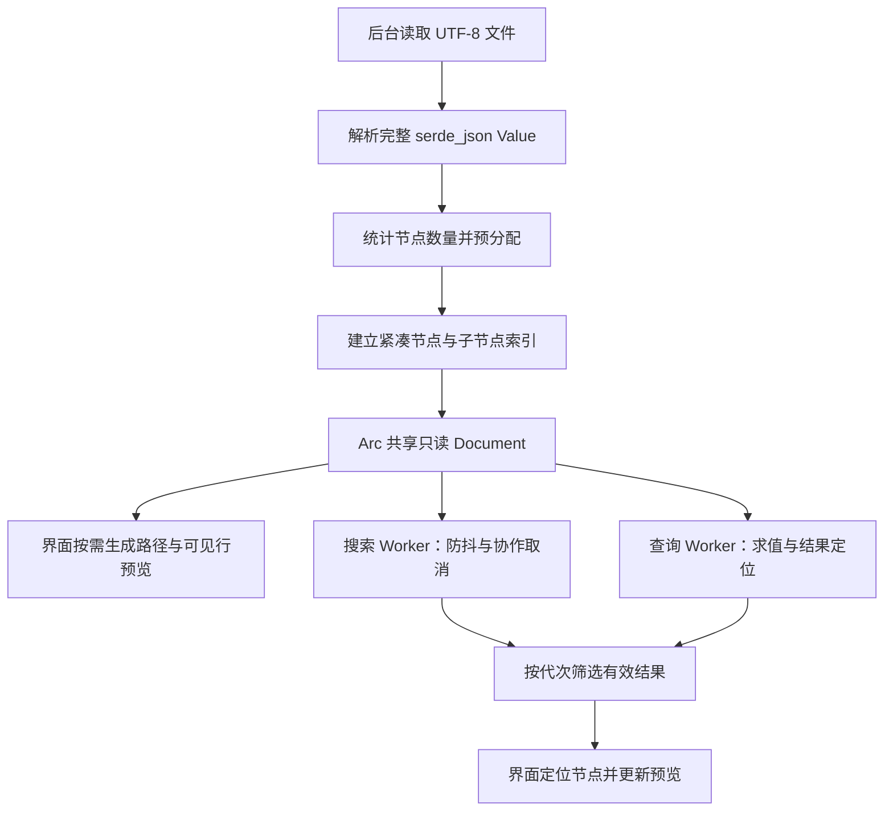

# FerrisJson 大文件优化记录：0.4.0–0.4.3

本文记录第一阶段及后续内存优化：在保留完整 `serde_json::Value` 和现有查询语义的前提下，压缩附加索引、减少字符串复制及临时分配，并将检索移出界面线程。第 15 节记录 0.4.2 的紧凑索引与低内存加载；第 16 节记录 0.4.3 的导出、复制、缓存和结果编号优化。

更新日期：2026-10-13，当前版本 0.4.3。第 1–13 节保留 2026-10-12 的第一阶段记录：实现与版本提交为 `c9f0415`（0.4.0），对照版本为 `455403f`（0.3.5）。第 14 节记录 0.4.1 的源文本释放和 Windows 内存基准；原始测量时包版本仍为 0.4.0，报告中的版本号保留原值，不改写历史样本。未来的大文件按需解析方案见 [todo.md](../todo.md)，不属于本文已经实现的功能。

## 1. 原实现为什么慢、为什么占内存

原加载流程是：读取整个文件为 `String`，解析为 `serde_json::Value`，再递归建立完整树索引。读取与解析虽然在后台执行，但在加载期间，源文本、Value 与正在建立的索引会同时占用内存。

原来的每个 `Node` 保存五个独立字符串：`key`、`pointer`、`path`、`preview` 和 `searchable`。这些数据与 Value 中的键和值存在重复：

- 对象键已经保存在 Value 中，又被节点复制一次。
- 字符串值已经保存在 Value 中，又被复制为完整的搜索字符串。
- 每个节点保存从根开始的两种完整路径，相邻节点重复保存大量共同前缀。
- 折叠、未显示的节点也会在加载时生成预览。

在本机 64 位构建中，原 Node 结构体为 176 字节，尚未计算字符串内容和分配器开销。`Vec` 扩容留下的容量余量还会放大索引占用。

原 JSONPath 流程每次都遍历所有节点，建立 `HashMap<&str, usize>`，随后把查询结果的位置转为 JSON Pointer 字符串，再查询这个映射。因此，即使只查询 `$.records[0].email`，也要支付一次全量索引构建成本。

原搜索在搜索框每次变化时执行，扫描所有节点并占用界面线程。读取文件异步，不能解决检索导致的界面停顿。

## 2. 优化后的整体流程



这仍然是完整内存文档模型。按需生成的是路径、树行标签和预览；文件本身并没有按需读取，Value 和结构索引也没有改为流式或磁盘存储。

## 3. 步骤一：压缩节点结构与共享键名

实现位置：[src/document.rs](../src/document.rs)，主要类型为 `Kind`、`Node`、`Document` 和 `IndexBuilder`。

### 3.1 节点只保存结构信息

新的 Node 保存：

| 字段 | 含义 |
| --- | --- |
| `parent` | 父节点 ID；根节点为 None |
| `depth` | 树层级，供缩进与初始展开使用 |
| `end` | 前序序列中子树结束后的第一个 ID |
| `segment` | 对象键的共享编号，或数组元素的整数下标 |
| `child_start` / `child_count` | 此节点的直接子节点在 children 数组中的范围 |
| `kind` | 类型枚举，按需得到类型名称及是否为容器 |

节点不再持有上述五个字符串。在本机 64 位构建中，Node 为 64 字节。这个值由实测和回归测试确认，不是跨所有架构的固定 ABI 承诺。

### 3.2 索引中的相同键名只保留一份内容

`Document.keys` 保存 `Arc<str>`，`key_ids` 将键名映射为共享编号。索引构建遇到重复的 `email` 时复用已有编号；节点只保存编号。keys 与 key_ids 中的 Arc 指向同一份字符串内容。

这里去重的是附加索引。原始 Value 中每个对象拥有的键名仍然存在，并未被改造成共享字符串。数组下标也只在节点中保存为整数，在需要显示时才转成字符串。

### 3.3 前序 ID 与查找顺序分开

节点按原 Value 的顺序进行前序编号，所以原始对象键顺序和数组顺序继续用于显示。`end` 使折叠容器时可以直接跳过整个子树，原有导航和展开/折叠逻辑继续使用同一套 ID。

另外建立一个 `children: Vec<usize>`，每个非根节点在其中有一条父子边。对象的直接子节点按共享键编号排序，以便二分查找；数组的直接子节点按下标排列。这个排序只改变查找表，不改变节点前序 ID 和显示顺序。

## 4. 步骤二：统计数量，减少扩容余量

`Document::parse` 先完成 Value 解析，再用 `node_count` 统计全部节点数 N，然后分别为 nodes 和 children 预分配 N 与 N−1 的容量。

这样避免两个大型数组在索引构建过程中不断增长、搬移，以及保留远高于实际长度的容量。代价是额外遍历一次 Value；它不复制字符串，也不构造路径。

对本机 64 位布局，结构数组的有效负载可近似表示为：

```text
节点数组 ≈ 64 × N 字节
子节点数组 ≈ 8 × (N − 1) 字节
总结构数组 ≈ 72 × N 字节
```

这是结构数组的估算，不是总进程内存。Value、共享键表、源文本、查询结果、界面状态、字体和分配器都需要另外计算。索引建立还包含对象子节点的局部排序，其成本随各对象的字段数量变化。

## 5. 步骤三：路径和值按结构定位

主要方法为 `at`、`key`、`ancestors` 和 `path`。

`at(id)` 沿父节点链找到对应 Value：对象通过共享键名访问，数组通过整数下标访问。这里返回原 Value 的引用，不复制选中值；也不再通过完整 JSON Pointer 字符串重新解释路径。

`key(id)` 用 `Cow<str>` 返回键：对象键与根标签借用现有内容，数组下标才生成临时字符串。

`path(id)` 只在需要选中路径、复制路径或命令行输出时生成完整 JSONPath。它从当前节点追溯父节点、反转祖先序列，再拼接对象名或数组下标。普通标识符使用点号，特殊键名使用经 JSON 转义的方括号字符串，保留中文、空键名、引号和斜杠等情况的可定位性。

这把原来按全部节点长期保存的路径，改为少数当前需要的临时路径。代价是获取值或生成路径需要沿深度 D 访问祖先，并不是所有节点访问都变成 O(1)。界面缓存当前选中路径，避免每帧重复构造。

用于路径回归检查的 `pointer` 方法仅在测试构建中启用；生产节点不保存完整 Pointer 字符串。

## 6. 步骤四：查询结果直接沿树定位

主要方法为 `child_name`、`child_index`、`pointer_id`、`query_path` 与 `query_path_cancellable`。

### 6.1 JSON Pointer

Pointer 被分成多个段，逐段访问对象或数组：

1. 检查 `~` 后只能跟 `0` 或 `1`。
2. 按正确顺序解码 `~1` 和 `~0`。
3. 对象名先查询共享键编号，再在该对象的直接子节点中二分定位。
4. 数组下标检查前导零、加号及范围，再直接访问对应子节点。

不再扫描所有节点去比较完整 Pointer。对象中的数字键名仍然作为字符串键处理，不能与数组下标混同。

### 6.2 JSONPath

表达式仍由 `serde_json_path` 解析和求值，调用 `query_located(&value)` 获取带位置的结果。每个结果的位置由 `PathElement::Name` 或 `PathElement::Index` 组成；代码从根节点依次沿这些元素定位到节点 ID。

因此删除了每次查询时的全量 Pointer HashMap，也避免把每个结果的位置先序列化为 Pointer 字符串。返回结果保持查询引擎给出的顺序，不排序、不去重；例如 `[1,0,1]` 会保留重复选择。

数组的单步结构定位为 O(1)，对象的单步定位包含共享键查询和直接子节点二分查找。精确小结果查询不再承担额外 O(N) 的映射构建开销，但这不意味着所有 JSONPath 都是常数时间。递归、通配符和过滤表达式仍可能遍历大量 Value，查询库也仍会构造完整的 LocatedNodeList。

## 7. 步骤五：搜索复用原始值与唯一键匹配

主要方法为 `search_cancellable` 与 `walk`。

搜索不再读取节点中的完整 `searchable` 副本，而是按与索引一致的前序顺序遍历原 Value。这保证遍历计数和节点 ID 对应，不需要为每个值调用从根开始的 `at`。

具体减少了以下工作：

- 每个唯一对象键仅匹配一次，结果存入临时 `key_matches`。节点用共享键编号复用结果。
- 字符串值直接匹配 Value 中的完整解码字符串，不能只搜索被截断的预览。
- 在已启用 arbitrary_precision 的配置下，数字用 `Number::as_str()` 匹配，不生成新的数字字符串；布尔与 null 使用静态文本。
- 普通文本搜索若包含非 ASCII 数字字符，就不可能匹配纯数字数组下标，因此跳过数组键的字符串转换与匹配。正则搜索继续匹配数组下标。
- All 模式中，键已匹配时不用再次检查值，因为每个节点只需返回一次。

匹配仍按前序 ID 返回，兼容当前的结果导航和二分高亮。大小写、正则、键/值范围和 Unicode 行为继续由现有正则引擎及回归测试保证。

搜索的主要复杂度仍与节点数和被匹配文本长度有关；这里没有建立全文倒排索引。结果 ID 也仍完整保存在 Vec 中，不是逐批返回或分页结果。

## 8. 步骤六：预览按需生成，并在输出上限处停止

实现涉及 `row_preview`、`SelectedValues`、`bounded_preview` 与 [src/app.rs](../src/app.rs) 中的行标签缓存和选中预览。

### 8.1 可见树行

只绘制可见行是已有能力，本次没有把它作为新功能。新增的是只为实际需要显示的行生成键标签和短预览，再缓存这些标签。

缓存最多保存 512 行。需要插入第 513 个不同节点时清空缓存再插入；这不是 LRU 淘汰。它限制缓存行数，不构成严格的总字节预算，因为原始键名可能很长。

字符串和数字的树行预览截取前 160 个字符，超出时添加省略号。完整值仍用于搜索、选中预览、复制和导出。选中节点未变化且已有预览时复用当前预览；新文档加载成功时清空行缓存和选中预览。

### 8.2 查询结果预览

之前先为所有结果解析 Value 引用并收集到一个 Vec，再执行有输出上限的格式化。结果数量很大时，即使只显示前 200 KB，也必须先处理全部结果引用。

现在 `SelectedValues` 实现 `Serialize`，通过 `SerializeSeq` 每次序列化一个结果。`bounded_preview` 的 writer 到 200,000 字节上限后返回截断错误，序列化立即结束，后续结果不再被解析成 Value 引用。

上限按字节计算，并在展示前保留完整 UTF-8 边界。完整复制/导出的 `results_json` 也使用逐项序列化，减少中间引用数组，但仍生成完整输出 String；它没有变成直接写磁盘的流式导出。

此改动缩小的是预览阶段的临时分配与访问范围，不能消除查询引擎先前已经生成的结果集合。大字符串单次匹配或序列化内部扫描仍可能花费时间，不能将输出上限解释为严格的 CPU 时间上限。

## 9. 步骤七：共享只读文档，后台执行检索

实现位置：[src/worker.rs](../src/worker.rs)；界面调用见 `search`、`go_to_path` 和 `poll_operations`。

Viewer 使用 `Arc<Document>`，Worker 通过 `Arc::clone` 共享只读文档，不复制整棵 Value 或索引。搜索和查询各使用一个独立 Worker，避免一个类型的任务直接阻塞另一个类型的任务。

每个 Worker 的容量约束是：

| 位置 | 约束 |
| --- | --- |
| 正在执行 | 一个任务 |
| 待执行 Inbox | 一个 Option，请求可被最新请求替换 |
| 完成结果通道 | `sync_channel(1)`，最多一个已缓冲结果 |

线程通过 Mutex 与 Condvar 等待新请求；界面用非阻塞轮询取结果。若结果通道满，等待发生在 Worker 的发送端。这个机制限制请求和结果堆积，不是每提交一次就新建线程。

它也不限制单个任务自身的结果大小。等待发送的 Worker 还可能持有自己的完成结果，活动任务也可能暂时保留旧文档的 Arc；不能把通道容量等同于完整进程内存上限。

完成后 Worker 请求界面重绘；有活动任务或防抖计时器时，界面另安排最多约 50 ms 间隔的轮询重绘。展示结果、展开祖先、更新选中值和树行仍在界面线程执行。

## 10. 步骤八：防抖、任务代次和取消边界

### 10.1 200 ms 防抖

搜索文本、大小写、正则或范围变化时，先失效旧搜索、清除旧匹配，再设置 200 ms 截止时间。连续输入重设截止时间，只在停顿后提交最新搜索。Enter 可直接调用 search，不必等截止时间。

防抖减少短时间内的重复全量扫描，但故意增加了输入后的等待时间。它改善交互，不等于一次搜索的计算速度提高。

### 10.2 代次保证结果属于当前请求

Worker 用 `AtomicU64` 保存 generation。取消或新提交递增代次，清空旧的待执行请求和已缓冲结果。每个请求、完成结果携带自己的代次。

Worker 在处理前后检查是否过期；Viewer 取结果时再次比较代次。过期结果不能覆盖最新搜索、最新查询或新加载的文档。清空搜索、清空/Reset 查询，以及新文档加载成功都会使相应任务失效。

### 10.3 协作取消不是随时强制中断

搜索在唯一键匹配和节点遍历中每 1024 项检查一次代次。取消后停止继续扫描，丢弃已收集的结果；单次正则匹配中的巨大字符串扫描仍不能在任意字节处被外部打断。

查询在求值前、求值后及每 1024 个结果定位时检查代次。现有库的 `query_located` 没有中途取消接口，所以表达式求值本身必须返回后才可继续检查。过期请求会跳过后续格式化，并在发送前再次检查代次。

因此旧的复杂查询可能继续占用查询 Worker 一段时间，但不会在界面线程求值或把旧结果展示为当前结果；期间待执行请求不断合并为最新一个。

## 11. 测量方法与结果

这次测量使用本机 macOS/arm64、Rust 1.99、优化编译的临时基准程序。程序读取文件，直接调用两个版本的 Document 实现，测量解析建索引、搜索和查询；进程峰值 RSS 用 macOS `/usr/bin/time -l` 的 maximum resident set size 记录。

输入为同一份 21,177,793 字节（约 20.2 MiB）的合成 JSON：根对象包含 records 数组，10 万条记录、1,300,002 节点。记录含数字 ID、email、多语种 name、布尔值、tags 数组、address 对象和任意精度大整数。原始数据构造方式为紧凑 JSON，记录结构如下：

```json
{
  "id": 0,
  "email": "user0@example.com",
  "name": "测试 사용자 テスト",
  "active": true,
  "tags": ["rust", "json", "viewer"],
  "address": {"city": "Shanghai", "code": 200000},
  "balance": 123456789012345678901234567890
}
```

以下是最后一次顺序运行的实际输出，时间保留两位小数，RSS 四舍五入为 MiB：

| 指标 | 原实现 | 优化后 |
| --- | ---: | ---: |
| 文件读取 | 9.59 ms | 12.27 ms |
| 解析 + 完整索引构建 | 515.85 ms | 149.87 ms |
| 进程峰值 RSS | 704 MiB | 318 MiB |
| Node 结构体大小 | 176 B | 64 B |
| nodes 容量对应的结构体空间 | 352.00 MiB | 79.35 MiB |
| 原节点五个字符串的容量合计 | 153.72 MiB | 不再保存在节点中 |
| 全范围、忽略大小写搜索 missing-needle（零匹配） | 19.44 ms | 11.43 ms |
| 全范围、忽略大小写搜索 email（10 万匹配） | 27.77 ms | 13.51 ms |
| 查询 `$.records[0].email`（一个匹配） | 45.87 ms | 0.10 ms |
| 查询 `$.records[*].email`（10 万匹配） | 97.62 ms | 36.95 ms |

峰值 RSS 原始值分别为 738,033,664 和 333,611,008 字节。它涵盖基准进程读取、索引、检索等阶段的峰值，不是只测 Node；优化后的 children 数组和共享键表也属于进程占用，不能用 nodes 的一行代替总索引占用。

这是单次基准，未做多次统计、冷缓存控制或独立阶段内存测量，且不含完整 GUI、字体、绘制或防抖等待。也不是工作区 `random-0.6gib.json` 的测量，不能直接外推其打开时间或内存。旧的另一轮测量为约 714 ms / 695 MiB，波动说明应在后续建立固定数据集与多次运行的基准。

## 12. 已完成验证与可重复检查

优化后主程序 31 项自动测试通过，覆盖特殊路径、共享索引、对象顺序、数组下标、JSONPath 重复结果、大整数、Unicode、搜索模式、预览早停、任务替换、代次过滤、新文档失效旧结果及防抖，并包含已有导航、配色与界面测试。

```sh
cargo fmt --check
cargo test --offline --locked
cargo clippy --offline --locked --all-targets -- -D warnings
cargo check --offline --locked --all-targets
```

首次使用 offline 前需要准备依赖。主程序测试数量不代表生成器 example 的测试已运行；生成器需另执行 `cargo test --offline --locked --example generate_json`。

macOS/arm64 App 已重新构建，Info.plist、ad-hoc 签名、JSONPath 与搜索 CLI 样例验证通过。该次构建发生在版本号仍为 0.3.5 时；随后提交 0.4.0 并通过全部目标的 cargo check。需要带 0.4.0 版本信息的最终产物时，重新执行：

```sh
cargo run --release --locked --example package
```

实际 Windows / Intel Mac 验收、真实大文件的完整 GUI 压测、多轮基准和大结果复制/导出尚未完成。

## 13. 第一阶段没有解决的部分

- 完整源文本在加载时与 Value/索引共存；完整 Value 和结构索引长期驻留。
- 旧文档在新文档加载期间仍供界面使用，旧活动任务也可能继续持有它，新旧文档会暂时重叠。
- 全局文本、正则、递归查询仍需访问大量数据；后台执行只改善界面响应，不能免去扫描。
- 搜索和查询返回完整结果列表，没有渐进批次、分页或结果数量预算。
- 表达式求值和单次正则匹配不是可任意打断的执行过程。
- 复制与导出仍可能创建完整格式化 String；树行缓存也只限制条目数。

下一阶段应评估原文件字节范围索引、按需子树解析、具有字节预算的缓存，以及与这种存储模型兼容的查询后端。具体待办和验收条件统一维护在 [todo.md](../todo.md)。

## 14. 0.4.1 — 释放源文本与 Windows 内存基准（2026-10-13）

本增量只实施内存基准入口和提前释放源文本。`Document::parse_owned(String)` 先保存原始字节数，沿用 serde_json 和 UTF-8 BOM 处理，得到完整 Value 后显式 `drop(text)`，随后调用 `from_value` 统计节点并构建索引。文件、粘贴/剪贴板、标准输入和 CLI 加载均使用该入口。完整 Value 不借用输入文本，所以释放源文本不影响后续导航、搜索、查询和导出。

历史 0.4.0 的流程在建索引期间同时持有源文本、Value 和索引；现在源文本只与解析阶段的 Value 重叠。读取和解析阶段仍需要完整源文本，本改动不等同于流式解析。旧文档在新文档加载期间的重叠、粘贴框保存的文本及剪贴板副本不在本次优化范围内。

### 14.1 复现

在仓库根目录执行（Windows PowerShell 或 PowerShell 7）：

```powershell
./scripts/measure-memory.ps1 -File examples/sample.json -Runs 3 -Output target/memory-benchmark-small.json
./scripts/measure-memory.ps1 -File random_300MiB.json -Runs 3 -Output target/memory-benchmark-300MiB.json
```

如果没有原始大文件，可先用现有流式生成器创建固定种子的另一份输入，然后将其作为新的基准数据集；其结果不能与不同 SHA-256 的原文件直接视为同输入比较：

```powershell
cargo run --release --offline --locked --example generate_json -- 300MiB target/benchmark-seed42.json 42
./scripts/measure-memory.ps1 -File target/benchmark-seed42.json -Runs 3 -Output target/memory-benchmark-seed42.json
```

脚本构建 Release example，每次启动独立子进程，交替运行 `retain` 和 `release`，默认各三次。两种模式使用同一份代码、解析器和索引构造；`retain` 显式保持源文本到索引完成，模拟旧 GUI 加载时的生命周期，随后也释放文本；`release` 在索引前释放文本，模拟新生命周期。这是控制变量对照，不是分别编译历史提交和当前 GUI 的测量。

报告记录文件字节数、SHA-256、节点数、节点结构体大小/容量、平台、架构、Rust 版本、处理器标识、逻辑处理器数、基准所在 Git 基础提交，以及读取、解析、源文本释放、统计节点与建索引、初始预览的耗时。新版入口还报告 nodes 与 children 两个数组的容量字节总数；它不包含 Value、键表、分配器和 GUI，不能当作总内存。

Windows 内存来自当前进程的 `GetProcessMemoryInfo`：工作集、峰值工作集、私有提交量和峰值进程提交量。按阶段保存快照，并报告加载完成后及进程峰值的三次中位数/最小值/最大值。峰值由系统进程计数器提供，不依赖定时采样是否抓到瞬时峰值。Windows 工作集口径不应直接与历史 macOS RSS 数字比较。非 Windows 的 Rust example 可输出耗时，但内存字段明确标记不可用；PowerShell 汇总脚本只支持 Windows。

总耗时包括阶段内存计数器调用、源文本释放和初始预览，统计节点与建索引暂为合并阶段。操作系统文件缓存不清空，首次样本不宣称是冷打开。测量对象是文档引擎，不包含 GUI、字体、展开状态/可见行、文档切换、搜索、JSONPath 或导出；这些仍在 TODO 的完整 P0 基准范围内。加载完成后的快照是文档仍存活时的即时工作集，不是长期空闲后的采样。

### 14.2 本机结果

平台为 Windows/x86_64，Rust 1.99.0，Release，AMD64 Family 25 Model 116 Stepping 1 / AuthenticAMD，16 个逻辑处理器。使用原工作区 `random_300MiB.json`：314,572,800 字节，21,409,599 节点，SHA-256 `FBDF8FEC8D25BA0C33245DB9AC6DBCD59F2D2B84B22728E30BA136C939BF9599`。原始生成种子未知，文件本身未修改或加入 Git。

以下结果来自单独运行的一组三次对照；前一轮与编译重叠的试跑不作为正式结果。两种模式的 nodes 数组均为 1,370,214,336 字节，仅结构数组就已占据大量空间。

| 指标（三次中位数） | retain：索引后释放 | release：索引前释放 |
| --- | ---: | ---: |
| 峰值工作集 | 5,752.90 MiB | 5,453.89 MiB |
| 加载完成后工作集 | 5,453.82 MiB | 5,453.89 MiB |
| 峰值进程提交量 | 5,930.16 MiB | 5,630.74 MiB |
| 文件读取 | 83.62 ms | 82.30 ms |
| Value 解析 | 3,956.47 ms | 3,979.34 ms |
| 统计节点与建索引 | 1,494.29 ms | 1,527.67 ms |
| 初始根节点预览 | 1.19 ms | 0.95 ms |
| 引擎加载总耗时 | 5,523.68 ms | 5,600.80 ms |
| 总耗时最小–最大 | 5,515.23–5,660.48 ms | 5,575.48–5,674.24 ms |

峰值工作集减少约 **299.01 MiB（5.20%）**，峰值提交量减少约 299.41 MiB。稳定文档存储没有改变，所以加载完成后的占用基本相同。总耗时中位数增加约 1.4%，两组范围有重叠，本次没有证据证明打开速度提升。

小样例已完成三次对照，规模较小，内存差异只有计数器/分配噪声，不据此计算百分比收益。原始大文件样本保存在 [memory-300MiB-windows.json](benchmarks/memory-300MiB-windows.json)，小样例样本保存在 [memory-small-windows.json](benchmarks/memory-small-windows.json)。大文件报告生成后，example 只补充了结构数组容量字段，已有耗时/内存采样逻辑未改变，因此该旧报告只含节点数组容量。

验证：`cargo fmt --check`、`cargo test --offline --locked --all-targets`（32 项主程序、3 项生成器、11 项 example 引用的文档测试）、Clippy 全部目标及 Windows Release 主程序构建通过。Release CLI 另检查了文件读取、Unicode JSONPath、大整数、BOM、标准输入和无效 JSON 的退出码/位置错误。自动测试覆盖特殊路径、对象顺序、查询/搜索及加载失效旧结果。完整 GUI 大文件内存和人工交互验收仍需另测。

## 15. 0.4.2 — 紧凑索引与低内存加载

本版本合并实施原建议 0.4.2 / 0.4.3 的范围，于 2026-10-13 经用户确认提交为 0.4.2。测量发生在版本更新之前，本地报告标记基础 Git 提交、工作区已修改及当时的 0.4.1 包版本；这不表示它们测量的是已提交的 0.4.1 实现。历史报告不覆盖、不改写，本次及以后样本、测试数据和基准 JSON 报告不纳入提交。

### 15.1 紧凑结构与整数边界

Node 的六个结构字段改为 u32：父节点、深度、子树结束位置、键编号/数组下标、子节点数组起始位置和直接子节点数量。类型枚举及对齐占余下 4 字节，节点实测为 **28 B**；children 元素改为 u32，实测为 **4 B**。完整 Value 和共享键表继续保留，路径按需生成，父节点/子树结束位置通过访问方法转换为 UI 使用的 usize。

父节点 `u32::MAX` 表示根节点没有父节点；节点总量最多为 `u32::MAX`，有效节点 ID 最大为 `u32::MAX - 1`，所以哨兵不会与真实父节点混淆。子树结束位置可以等于节点总量。统计使用 checked_add 并检查 u32 范围，索引构建中的编号转换也使用 try_from；超限在分配索引前返回明确错误，不截断为低位编号。完整 Value 解析发生在统计之前，因此这不是对解析阶段的总内存保护。

结构数组容量公式从 `64N + 8(N−1)` 降为 `28N + 4(N−1)`。300 MiB 文件的 21,409,599 节点对应 **1,470.08 → 653.37 MiB**，减少约 816.71 MiB。这只是 nodes/children 的容量，不包含 Value、键表或分配器。

可见行和搜索结果仍使用 Vec<usize>。新增 `tree` 场景实际构建全部可见行，并使用正则 `.*` 匹配所有节点，保留这两个数组同时测量。对 300 MiB 文件，每个数组 21,409,599 项，因 Vec 扩容余量，容量均为 **256 MiB**，展开 Vec<bool> 容量为 **20.42 MiB**（Rust Vec<bool> 每项一个字节）。如果未来将这两个 ID 数组改为 u32 并保持同容量，可各节省约 128 MiB；本次只做评估，没有改动这些接口。分页和查询库 LocatedNodeList 的峰值仍需一起评估。

### 15.2 低内存加载与任务生命周期

工具栏新增 **Low memory load** 开关，默认关闭，与现有配置一起保存；旧配置缺少该字段时为 false，恢复配色默认值时保留开关。

关闭时沿用原行为：新文档在后台读取/解析，旧文档可继续浏览，失败后旧文档仍存在。开启时，文件及文本加载都执行以下顺序：

1. 取消旧搜索、查询及防抖任务，取走界面的旧文档引用，释放可见行、展开状态、匹配列表、查询结果、预览、行标签和导航历史的容量。
2. 后台加载线程持有旧文档最后一个预留 Arc，等待其他持有者释放引用。期间显示 “Waiting for previous document...” ，界面线程不阻塞。
3. 其他引用释放后，加载线程同步销毁旧文档，等析构结束才开始读取/解析新文件。
4. 加载失败时界面为空并提示旧文档必须重新打开；成功后重新建立视图状态。

不能仅用 Weak 的 strong_count 为零判断析构完成，因为 Arc 在销毁内容之前先将强引用数减到零。本实现让加载线程保留最后一个 Arc，等 strong_count 为一再 drop，确保文档析构在新文件读取前完成。Worker 在可能阻塞的结果通道发送之前显式释放 Document，避免满通道把旧文档拖住。关闭 Viewer 会设置取消标志，使等待线程停止，不在等待结束后启动新加载。

现有 JSONPath 库的求值仍没有中途取消接口；低内存模式必须等旧求值返回并释放引用。它不能承诺复杂查询立即中断。文本加载时新文本已经由粘贴/标准输入提供，等待期间也会占内存；粘贴编辑框的副本、读取后的完整 Value、现有预览上限和复制/导出行为仍保留。本次没有实现扫描/解析过程中随时取消。

### 15.3 基准与复现

仍使用 Windows/x86_64、Rust 1.99.0、Release、三次独立进程、未控制 OS 文件缓存的口径。300 MiB 输入与第 14 节 SHA-256 一致。新报告的 `retain` / `release` 使用同一份新紧凑结构，只比较源文本释放时机；结构压缩的前后比较使用第 14 节历史报告和本批 `release` 报告，不能把新报告内部两个模式当作结构布局对照。

| 指标（三次中位数） | 0.4.1，64 B 节点 | 0.4.2 实现，28 B 节点 |
| --- | ---: | ---: |
| 300 MiB 文件加载完成后工作集 | 5,453.89 MiB | 4,637.13 MiB |
| 进程峰值工作集 | 5,453.89 MiB | 4,637.13 MiB |
| 引擎加载总耗时 | 5,600.80 ms | 5,947.98 ms |

常驻工作集减少 **816.77 MiB（14.98%）**。总耗时中位数约增加 6.2%，两组在不同时段测量，未控制硬件/系统负载，不能归因于单个阶段；本批未证明打开速度提升，重点为内存占用。

切换场景使用生成器的 **20 MiB、种子 42** 输入（1,433,459 节点），SHA-256 `6C7FC6EA18A4F5115E33E43603A69C9DF165C51D0FA385B963393350B74D1AFB`。每个独立进程加载同一文件两次，普通模式保留旧文档至新文档完成，低内存模式使用与 GUI 相同的 release_previous 函数提前销毁旧文档。测量不包括 GUI 或活动查询，也没有复制 300 MiB 文件做两文档重叠压测。

| 指标（三次中位数） | 普通切换 | 低内存切换 |
| --- | ---: | ---: |
| 进程峰值工作集 | 625.60 MiB | 316.90 MiB |
| 切换耗时（含旧文档销毁与新预览） | 514.26 ms | 511.74 ms |

`tree` 场景的 300 MiB 文件全展开并全部节点匹配时，峰值工作集为 **5,077.52 MiB**，最终即时工作集为 **4,984.91 MiB**；可见行生成耗时中位数 **106.80 ms**，搜索耗时 **1,408.94 ms**。该场景不包含 GUI 绘制和 JSONPath。

```powershell
./scripts/measure-memory.ps1 -File random_300MiB.json -Runs 3 -Output target/memory-compact-300MiB.json
cargo run --release --offline --locked --example generate_json -- 20MiB target/memory-switch20MiB-seed42.json 42
./scripts/measure-memory.ps1 -File target/memory-switch20MiB-seed42.json -Scenario switch -Runs 3 -Output target/memory-switch20MiB.json
./scripts/measure-memory.ps1 -File random_300MiB.json -Scenario tree -Runs 3 -Output target/memory-tree-300MiB.json
```

生成器拒绝覆盖已有文件；复测可直接复用同一输入并核对 SHA-256。本次原始报告仅保存在本地 `target/memory-compact-300MiB.json`、`target/memory-switch20MiB.json` 和 `target/memory-tree-300MiB.json`，不随提交分发；上面的命令可重新生成。结构报告生成后，example 只继续增加 tree 场景，原 open 场景采样流程未变。

验证：39 项主程序测试、3 项生成器测试、14 项 benchmark 引用测试、格式、Clippy 全部目标和 Windows Release 构建通过（当时包版本 0.4.1）；0.4.2 版本更新后全部目标 cargo check 通过，依赖未改变。新增回归包括 u32 边界/根哨兵、空容器、旧引用释放顺序、取消等待、满结果通道、低内存文本/文件失败及后续恢复、普通模式失败保留旧文档和设置默认/序列化。GUI 连续切换、复杂查询等待、重启恢复和真实大文件人工验收尚未执行；版本提交不表示这些验收已完成。

## 16. 0.4.3 — 流式输出与紧凑行/结果数组

本版本合并实施原建议 0.4.3 / 0.4.4 范围，基于 `3b4c293`，于 2026-10-13 经用户确认提交为 0.4.3。测量发生在版本更新前，报告保留当时的 0.4.2 包版本及工作区已修改标记，不改写为 0.4.3 测量。所有新 JSON 输入与基准报告只保存在本地 target，文档记录结论和复现命令，不将样本加入版本库。

### 16.1 输出、复制和输入缓冲区

新增 `src/export.rs`，GUI 导出捕获共享 Document 和选中范围，在一个后台线程中直接序列化到文件。多结果用 Arc<Vec<u32>> 共享编号，不复制整个结果列表，也不先收集全部 Value 引用或构建完整输出 String。一次只允许一个导出，完成结果通过通道返回；界面定时轮询并显示取消按钮。

在目标文件同一目录用 create_new 创建唯一 `.FerrisJson-export-*.tmp`，使用 64 KiB BufWriter。writer 将大块输出拆成最多 64 KiB 的写入，在每次写入和 flush 检查取消；序列化、flush、sync_all 成功且取消未生效后，关闭句柄并 rename 替换目标。错误或替换前取消会删除临时文件，原目标保持不变。Windows 测试覆盖已有文件替换和失败/取消保留原内容。最终替换是提交点，迟到的取消不能回滚已完成导出；阻塞中的系统 I/O 也不能被取消标志强制打断。

低内存加载会取消活动导出，并通过已有文档引用等待逻辑确保导出释放旧 Document 后再加载。关闭 Viewer 取消导出并等待该线程清理，避免正常关闭进程时杀掉线程留下未清理临时文件。CLI 的 `--get`、`--query` 和 `--pretty` 同样逐项写入缓冲 stdout，保留原输出格式和末尾换行，不再生成整个格式化 String。

完整 JSON 复制先使用有 **8 MiB** 输出预算的 writer。超限立即返回专用状态，丢弃临时缓冲，不把预览或半份 JSON 放进剪贴板。弹窗提供 **Copy anyway / Export instead / Cancel**；只有继续复制时才完整物化输出，并明确提示内存增长和界面暂停。预算不包含文档、编号、系统剪贴板内部副本或用户确认后的输出，不能解释为总内存上限。

粘贴编辑框用 mem::take 转交原 String，输入框外的 Paste 事件同样移动缓冲区。正常解析后仍先释放源文本再建索引；语法错误通过独立通道将原分配交回编辑框，保留原文供修正，不通过克隆实现恢复。结构索引错误发生在源文本已释放后，不承诺恢复该输入。

### 16.2 缓存与编号数组

新增 `src/row_cache.rs`：行标签缓存按 String::capacity 统计实际字符串容量，预算 **1 MiB**，LRU 逐条淘汰；超过预算的单行只临时用于当前绘制，不留存。条目元数据另以最多 **512 条**约束，清空时释放容器容量。字节预算不包括 HashMap/队列元数据、egui 排版和临时超长行，因此不声称缓存预算就是完整 GUI 内存。

可见行、搜索结果和 JSONPath 结果由 Vec<usize> 改为 Vec<u32>。文档构建已验证节点 ID 范围，UI/CLI 只在访问节点和导航边界转换为 usize；数组顺序不变，JSONPath 重复选择继续保留。结果数量本身仍是 usize，查询库仍完整物化 LocatedNodeList，本改动没有实现结果分页或总字节预算。

可见行重建先沿展开状态统计实际行数，再清空并复用原缓冲区。需要增长时按行数预分配，余量最多 65,536 项（256 KiB），且不超过文档节点数。大幅折叠、旧容量超过 max(4096, 新行数×2) 时释放过大分配。该算法避免每次重建同时持有两份行数组，但仍需要遍历结构，不能等同于可见行分页。

搜索结果按倍增扩容，使用 reserve_exact 将最终容量限制在文档节点数内；每个节点最多返回一次，所以不会因几何增长超出总节点数。清空或新检索先释放旧匹配容量，减少新旧结果重叠。查询结果编号用 Arc 与复制/导出共享，避免后台导出快照克隆大型 Vec。

### 16.3 实测

Windows/x86_64、Rust 1.99.0、Release、三次独立进程，OS 缓存和系统负载未控制。全展开/全匹配使用与第 15 节相同的 300 MiB 文件和 SHA-256，21,409,599 节点。前后数组容量与长度有明确口径，工作集比较来自不同时段，不能承诺所有文件具有相同比例。

| 指标（三次中位数） | 0.4.2 原实现 | 0.4.3 实现 |
| --- | ---: | ---: |
| 可见行数组容量 | 256 MiB | 81.67 MiB |
| 搜索结果数组容量 | 256 MiB | 81.67 MiB |
| 全展开/全匹配峰值工作集 | 5,077.52 MiB | 4,867.71 MiB |
| 最终即时工作集 | 4,984.91 MiB | 4,821.34 MiB |
| 首次生成行数组 | 106.80 ms | 58.87 ms |
| 全匹配搜索 | 1,408.94 ms | 1,083.03 ms |

两个数组合计容量减少 **348.66 MiB**；峰值工作集减少约 **209.80 MiB**，即时工作集减少约 **163.56 MiB**。未触碰的容量页不一定进入工作集，所以不能把数组容量差直接当成 RSS 差。三次重复重建均复用同一分配，重建耗时中位数 **46.12 ms**。新基准多包含一次重建，不用前后进程 total_ms 比较打开速度。

导出对照在同一新文档引擎中比较旧“完整 String + write”与新 atomic_write，输入为第 15 节的 **20 MiB、种子 42** 文件。每次输出根节点，格式化文件均为 **36,381,124 字节**；旧模式 String 容量为 **64 MiB**，新模式没有完整输出 String。

| 指标（三次中位数） | 完整 String 导出 | 流式导出 |
| --- | ---: | ---: |
| 进程峰值工作集 | 380.77 MiB | 315.82 MiB |
| 导出耗时 | 118.64 ms | 203.38 ms |

峰值工作集减少约 **64.95 MiB**；流式模式额外包含临时文件、flush/sync 和替换，因此不宣称导出加速。此基准不包括 GUI、文件对话框、超大复制确认或大量 JSONPath 结果求值。单元测试另外验证多结果的顺序、重复项、Unicode 和大整数输出。

```powershell
./scripts/measure-memory.ps1 -File random_300MiB.json -Scenario tree -Runs 3 -Output target/memory-tree-compact-results-300MiB.json
./scripts/measure-memory.ps1 -File target/memory-switch20MiB-seed42.json -Scenario export -Runs 3 -Output target/memory-export-stream20MiB.json
```

20 MiB 输入生成命令见第 15 节；报告和输入不提交。导出基准使用 target 中独立进程专属目录，测量后删除它创建的输出文件和目录。

验证：47 项主程序、3 项生成器、19 项 benchmark 引用测试、格式、Clippy 全部目标和 Windows Release 构建通过（当时包版本 0.4.2）；0.4.3 版本更新后全部目标 cargo check 通过，依赖未改变。Release CLI 另验证了查询顺序/重复项、特殊 Pointer、大整数、搜索顺序、标准输入/pretty、零结果及无效 JSON 退出码；Windows PowerShell 使用显式输出管道等待 GUI 子系统程序退出。新增回归覆盖临时文件清理/错误/取消/替换、复制边界、粘贴分配恢复、LRU/预算、紧凑数组、折叠容量释放、行缓冲复用，以及原有查询顺序、重复项、搜索、导航和异步代次。文件对话框、弹窗实际点击、GUI 连续导出/取消、长键滚动、加载与导出交错等人工验收仍待完成；版本提交不表示这些验收已完成。
